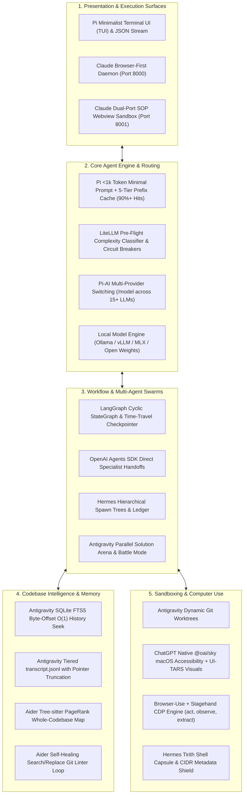

# Harness-Zero: The Universal Sovereign Autonomous Agent Engine

> **Reverse-Engineered Blueprints & Engineering Specifications Synthesized from:**
> Google Antigravity · OpenAI ChatGPT Desktop (Codex) · Anthropic Claude Cowork (Operon) · Hermes · Pi · Aider · LangGraph · Browser-Use · Stagehand · LiteLLM · ByteDance UI-TARS · Alibaba Qwen-Agent

---

## 1. What is Harness-Zero?

**Harness-Zero** is a next-generation, local-first, universal autonomous coding agent harness. It addresses the fragmentation across proprietary AI applications by extracting and uniting the single greatest engineering superpower from each frontier system:



---

## 2. Core Superpowers Unified in Harness-Zero

1. **Universal BYOK & Local-First Freedom**:
   * Support any cloud API key (OpenAI, Anthropic, Gemini, DeepSeek, OpenRouter, GLM) or run 100% offline via **Ollama / vLLM / Apple MLX** (`Qwen-2.5-Coder-32B`, `DeepSeek-R1`).
2. **Deterministic Prompt Caching (90%+ Hits)**:
   * 5-tier prefix-invariant prompt layout delivers 3–5x lower latency and up to 90% cost savings.
3. **Dual-Port Browser SOP Origin Sandbox**:
   * API on Port 8000, untrusted HTML preview origin on Port 8001, cryptographically preventing prompt-injection XSS.
4. **Git Worktree Subagent Sandboxing**:
   * Parallel worker agents operate in zero-collision isolated Git branches (`git worktree add`).
5. **SQLite FTS5 Byte-Offset Instant Memory Seeking**:
   * Microsecond $O(1)$ random access to any past conversational turn across weeks of work.
6. **Whole-Codebase Tree-sitter PageRank Repo Map**:
   * Dense AST symbol graph packing a 100k-line codebase into an ultra-lean 1k-token API map.
7. **Hybrid Desktop & Browser Computer Use**:
   * Native macOS Accessibility (`AXUIElement`) + UI-TARS pixel visual grounding fallback + Chrome DevTools Protocol (`act`, `observe`, `extract`).
8. **Multi-Agent Battle Arena & State Graphs**:
   * Cyclic LangGraph workflows with time-travel checkpoints, plus Antigravity's Battle Mode for competitive solution ranking.

---

## 3. Complete Specification Suite (`docs/`)

All 22 modular engineering blueprints, protocol schemas, and reference implementations are available in [`docs/`](docs/):

| Document | Topic | Description |
| :--- | :--- | :--- |
| [`00_README_AND_MANIFEST.md`](docs/00_README_AND_MANIFEST.md) | Master Index | System overview, architectural goals, and quick-start roadmap. |
| [`01_SYSTEM_TOPOLOGY_AND_ENGINE_DESIGN.md`](docs/01_SYSTEM_TOPOLOGY_AND_ENGINE_DESIGN.md) | System Topology | Process separation, Go vs Node vs Rust vs Bun daemons, daemon supervision. |
| [`02_IPC_PROTOCOLS_AND_EVENT_STREAMING.md`](docs/02_IPC_PROTOCOLS_AND_EVENT_STREAMING.md) | Wire Protocols | ConnectRPC, JSON-RPC 2.0, SSE frames, reactive non-polling wakeup engine. |
| [`03_CONTEXT_ENGINE_AND_TRANSCRIPT_STORAGE.md`](docs/03_CONTEXT_ENGINE_AND_TRANSCRIPT_STORAGE.md) | Context & Transcripts | `transcript.jsonl` compact schema, pointer truncation, compaction algorithms. |
| [`04_PROGRESSIVE_SKILLS_AND_PLUGIN_SYSTEM.md`](docs/04_PROGRESSIVE_SKILLS_AND_PLUGIN_SYSTEM.md) | Skills & Plugins | Progressive disclosure via YAML frontmatter, plugin manifests, MCP lifecycle. |
| [`05_EXECUTION_SANDBOX_AND_GIT_WORKTREES.md`](docs/05_EXECUTION_SANDBOX_AND_GIT_WORKTREES.md) | Sandboxing & Workspaces | Subagent isolation with Git worktrees, terminal virtualization, supervisor loop. |
| [`06_COMPUTER_USE_AND_DESKTOP_INTEGRATION.md`](docs/06_COMPUTER_USE_AND_DESKTOP_INTEGRATION.md) | Desktop Automation | `@oai/sky` API, macOS Accessibility (`AXUIElement`), ScreenCaptureKit, REPL runner. |
| [`07_GENERATIVE_UI_AND_ARTIFACT_SYSTEM.md`](docs/07_GENERATIVE_UI_AND_ARTIFACT_SYSTEM.md) | Generative UI & Artifacts | Document versioning, metadata schema, sandboxed iframe rendering, live diffs. |
| [`08_BUILD_BLUEPRINT_AND_STARTER_IMPLEMENTATION.md`](docs/08_BUILD_BLUEPRINT_AND_STARTER_IMPLEMENTATION.md) | Complete Implementation | Phased roadmap, project layout, and fully functional runnable Python scaffold. |
| [`09_SEARCH_INDEXING_AND_SQLITE_FTS5_ENGINE.md`](docs/09_SEARCH_INDEXING_AND_SQLITE_FTS5_ENGINE.md) | Long-Term Memory | Embedded SQLite FTS5, byte-offset instant seek into transcripts, BM25 ranking. |
| [`10_PROMPT_CACHING_AND_PREFIX_INVARIANCE.md`](docs/10_PROMPT_CACHING_AND_PREFIX_INVARIANCE.md) | Token Economics & Speed | Achieving 90%+ prompt cache hit rates via strict deterministic prefix invariants. |
| [`11_MULTI_AGENT_ARENA_AND_BATTLE_EVALUATOR.md`](docs/11_MULTI_AGENT_ARENA_AND_BATTLE_EVALUATOR.md) | Competitive Exploration | Antigravity Battle Mode, Rust CellActor pattern, automated scoring and merging. |
| [`12_TOOL_SAFETY_GUARDRAILS_AND_PERMISSIONS.md`](docs/12_TOOL_SAFETY_GUARDRAILS_AND_PERMISSIONS.md) | Security & Permissions | Human-in-the-loop state machine, destructive regex classifiers, path guards. |
| [`13_CLAUDE_COWORK_OPERON_ARCHITECTURE.md`](docs/13_CLAUDE_COWORK_OPERON_ARCHITECTURE.md) | Claude Cowork (Operon) | Bun compiled daemon, Dual-Port origin separation (Port 8000/8001), CIDR guards. |
| [`14_THE_ULTIMATE_HYBRID_HARNESS_SYNTHESIS.md`](docs/14_THE_ULTIMATE_HYBRID_HARNESS_SYNTHESIS.md) | Master Omni-Blueprint | Feature mashup matrix combining all engines into one unified architecture. |
| [`15_HERMES_MULTI_AGENT_AND_TIRITH_SECURITY.md`](docs/15_HERMES_MULTI_AGENT_AND_TIRITH_SECURITY.md) | Hermes Engine | Hierarchical spawn trees, SQLite state machine with WAL, and Tirith security. |
| [`16_PI_MINIMALIST_AGENT_AND_CHORD_RUNTIME.md`](docs/16_PI_MINIMALIST_AGENT_AND_CHORD_RUNTIME.md) | Pi Engine | Ultra-compact (<1k token) prompt, universal `pi-ai` multi-provider layer, and model switching. |
| [`17_AIDER_REPOMAP_AND_ARCHITECT_EDITOR_LOOP.md`](docs/17_AIDER_REPOMAP_AND_ARCHITECT_EDITOR_LOOP.md) | Aider Engine | Tree-sitter PageRank repo map, Architect/Editor dual-model pattern, self-healing. |
| [`18_BROWSER_COMPUTER_USE_AND_CDP_STAGEHAND_ENGINE.md`](docs/18_BROWSER_COMPUTER_USE_AND_CDP_STAGEHAND_ENGINE.md) | Browser Computer Use | Chrome DevTools Protocol (CDP), pruned accessibility trees, Stagehand `act`/`observe`/`extract`. |
| [`19_STATE_GRAPH_ORCHESTRATION_AND_AGENT_HANDOFFS.md`](docs/19_STATE_GRAPH_ORCHESTRATION_AND_AGENT_HANDOFFS.md) | Graph Workflows | LangGraph cyclic StateGraphs, persistent checkpoints for time-travel, and agent handoffs. |
| [`20_INTELLIGENT_MODEL_ROUTING_AND_FAILOVER_CIRCUITS.md`](docs/20_INTELLIGENT_MODEL_ROUTING_AND_FAILOVER_CIRCUITS.md) | Model Routing | LiteLLM / OpenRouter pre-flight intent classification, tiered pools, and circuit breakers. |
| [`21_BYOK_LOCAL_MODELS_AND_OPEN_HARNESS_SYNTHESIS.md`](docs/21_BYOK_LOCAL_MODELS_AND_OPEN_HARNESS_SYNTHESIS.md) | BYOK & Local Models | Ollama/vLLM local inference, UI-TARS visual $(x,y)$ coordinate grounding, and Qwen XML tool adapter. |

---

## 4. Getting Started & Running the Harness

Harness-Zero is implemented as a high-performance Python 3.11+ engine with zero external daemon bloat.

### Installation

```bash
# Clone the repository
git clone https://github.com/knarayanareddy/Harness-Zero.git
cd Harness-Zero

# Create virtual environment and install with uv
uv venv
source .venv/bin/activate
uv pip install -e ".[dev]"
```

### Running Autonomous Turns

```bash
# Run a single turn with your chosen model provider:
harness run "Analyze repository structure and run test suite" --workspace . --provider mock

# Use cloud BYOK (OpenAI, Anthropic, Gemini, DeepSeek, OpenRouter):
export ANTHROPIC_API_KEY="sk-ant-..."
harness run "Refactor database migrations" --provider anthropic --model claude-3-5-sonnet-latest

# Or run 100% offline via local Ollama / vLLM / MLX:
harness run "Fix unit tests" --provider local --model qwen2.5-coder:32b
```

### Interactive Pair-Programming TUI

Start an interactive pair-programming session with full slash command support:

```bash
harness interactive
```

Available slash commands within the session:
* `/skills` - View all progressively discovered skills across Workspace, User, and Builtin tiers.
* `/model <provider> <model>` - Switch active model dynamically mid-session.
* `/search <query>` - Instant O(1) byte-offset search through conversation history via SQLite FTS5.
* `/tasks` - Inspect running background commands and async workers.
* `/status` - Display active session IDs, memory databases, and transcript logs.
* `/help` - Show all interactive commands.
* `/exit` - Terminate session cleanly.

### Running the Daemon IPC Server

Expose Harness-Zero over JSON-RPC 2.0 / REST API for web or external client connections:

```bash
harness daemon --port 8080 --host 127.0.0.1
```

### Running the Test Suite

```bash
pytest -v
```
All 15 modular test suites verify:
- Progressive skill discovery and YAML frontmatter parsing
- Tiered `transcript.jsonl` logging and O(1) byte-offset seeking
- SQLite FTS5 instant memory indexing and BM25 ranking
- Safe shell execution with `PAGER=cat` and background transitions
- Tool safety guardrails and destructive command regex gating
- Aider search/replace surgical diff application
- Strict 5-tier deterministic prefix-invariant prompt caching
- End-to-end multi-turn reactive coordinator tool loops
- Git worktree dynamic subagent sandbox lifecycle