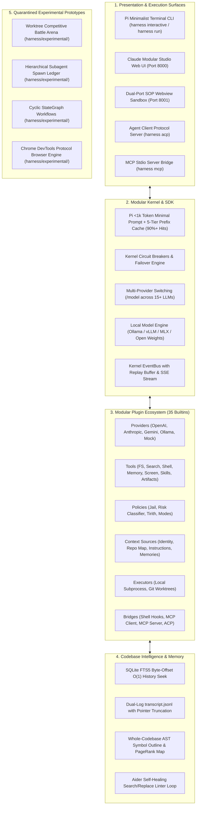

# Harness-Zero: The Universal Sovereign Autonomous Agent Engine

> **Reverse-Engineered Blueprints & Engineering Specifications Synthesized from:**
> Google Antigravity · OpenAI ChatGPT Desktop (Codex) · Anthropic Claude Cowork (Operon) · Hermes · Pi · Aider · LangGraph · LiteLLM · Alibaba Qwen-Agent

---

## 1. What is Harness-Zero?

**Harness-Zero** is a next-generation, local-first, universal autonomous coding agent harness. It addresses the fragmentation across proprietary AI applications by uniting the greatest engineering superpowers into a modular kernel and SDK architecture:



---

## 2. Implementation Status

| Feature / Subsystem | Status | Description |
| :--- | :--- | :--- |
| **Modular Kernel & SDK** | **Implemented** | Strict boundary enforcement (`harness.sdk`), event bus, capability gates. |
| **Universal BYOK Providers** | **Implemented** | Native streaming, tool calling, and prompt caching for OpenAI, Anthropic, Gemini, Ollama, and Mock. |
| **5-Tier Prefix-Invariant Caching** | **Implemented** | Static, session, and turn stability layout delivering 90%+ cache hits on Anthropic and OpenAI. |
| **Dual-Origin Web Studio** | **Implemented** | Port 8000 API, Port 8001 SOP preview iframe, token authentication, card event stream (`harness ui`). |
| **Tirith Security Capsule & Jail** | **Implemented** | Path jail (Order 10), risk classification (Order 50), secret leak auditing and SSRF protection (Order 60). |
| **Permission Modes State Machine** | **Implemented** | `plan`, `ask`, `allow`, and `bypass` execution modes with live interactive card approvals. |
| **Git Worktree Isolation** | **Implemented** | Scratch branch isolation (`git worktree add -b`) preventing collisions across subagents. |
| **SQLite FTS5 Memory** | *Partial* | FTS5 search store and memory recall tools implemented; automated transcript indexing wired via store plugins. |
| **Codebase Symbol Repo Map** | **Implemented** | AST symbol extraction and ranking packing large repos into compact prompt context. |
| **Native macOS Computer Use** | *Partial* | Screen capture tool via macOS `screencapture` implemented; native `AXUIElement` accessibility automation planned for desktop bridge. |
| **Claude Code Shell Hooks Bridge** | **Implemented** | HookKit-conformant execution of Claude Code scripts on tool events with stdin JSON. |
| **MCP Client & Server Bridges** | **Implemented** | Stdio JSON-RPC 2.0 MCP client (auto-discovering tools/resources) and stdio MCP server (`harness mcp`). |
| **Agent Client Protocol (ACP)** | **Implemented** | Stdio server frontend for editor and IDE integration (`harness acp`). |
| **Plugin Scaffolding & Doctor** | **Implemented** | `harness plugin new`, `harness plugin test`, and `harness plugin doctor` diagnostic tooling. |
| **Multi-Agent Battle Arena** | *Experimental* | Competitive worktree evaluation quarantined in `harness/experimental/` pending `spawn_child`. |
| **Hierarchical Spawn Ledger** | *Experimental* | Subagent spawn tracking quarantined in `harness/experimental/` awaiting subagent spawn tool. |
| **Cyclic StateGraph Engine** | *Experimental* | State machine with rollback checkpointer quarantined in `harness/experimental/`. |
| **Browser CDP Engine** | *Experimental* | Chrome DevTools Protocol engine quarantined in `harness/experimental/browser_cdp.py`. |

---

## 3. Getting Started

### Installation

```bash
# Clone the repository
git clone https://github.com/knarayanareddy/Harness-Zero.git
cd Harness-Zero

# Create virtual environment and install in editable mode
uv venv
source .venv/bin/activate
uv pip install -e ".[dev]"
```

### Running the Web Studio (`harness ui`)

Launch the local Sovereign Agent Studio web interface with dual-origin sandbox isolation:

```bash
harness ui --port 8000 --sandbox-port 8001
```

- **Authentication**: Generates a random cryptographic session token written to `.harness/daemon.json` (0600 permissions).
- **Dual-Origin Security**: Core API and event bus stream on `http://127.0.0.1:8000`; untrusted HTML and SVG artifacts render inside a sandboxed iframe on `http://127.0.0.1:8001`, cryptographically preventing XSS prompt-injection attacks.
- **Host Header Protection**: Blocks DNS rebinding attacks; add external origins via `--allow-host`.
- **Sessions are kernel-owned**: the daemon resumes the workspace's last conversation on start and creates a session on the first prompt; the client never creates one at boot.
- **Styling**: two stylesheets, `static/styles.css` (components) and `static/vendor/tw.css` (utilities compiled from the templates). After editing class names in `index.html` / `*.js`, run `npm run build:css` and commit the result; `python tests/frontends/ui_audit.py --strict` checks the page stays coherent (CI runs both).

### Running Interactive CLI Turns

```bash
# Start an interactive pair-programming session (resumes the last conversation; --new starts fresh):
harness interactive

# Run a single autonomous command in a new session (--continue appends to the last conversation):
harness run "Audit repository dependencies and run tests" --workspace . --provider anthropic --model claude-3-7-sonnet
```

### Protocol Bridges

```bash
# Run stdio MCP Server (exposing Harness tools to external hosts):
harness mcp

# Run Agent Client Protocol (ACP) stdio server for IDEs:
harness acp
```

### Managing & Testing Plugins

```bash
# Scaffold a new plugin:
harness plugin new --kind context my_rules

# Run conformance tests on a plugin:
harness plugin test ./my_rules

# Run conformance tests on all 35 builtin plugins:
harness plugin test --all

# Run diagnostic health checks on plugins:
harness plugin doctor --all
```

---

## 4. Verification & Testing

Harness-Zero uses hermetic, isolated test fixtures that never pollute `$HOME` or external environments:

```bash
# Run the complete test suite (56+ test files, 340+ tests):
export HOME=$(mktemp -d) HARNESS_CONFIG_DIR=$HOME/.harness
pytest -q

# Run architectural boundary enforcement tests:
pytest tests/kernel/test_import_boundaries.py tests/kernel/test_no_direct_subprocess.py tests/kernel/test_gate_invariants.py

# Verify code formatting and linting:
ruff check .
```

---

## 5. Documentation Suite

- [`docs/PLUGIN_CATALOG.md`](docs/PLUGIN_CATALOG.md): Complete catalog and specification of all 35 builtin plugins.
- [`docs/PORTING_RECIPES.md`](docs/PORTING_RECIPES.md): Step-by-step developer guide and code recipes for authoring new plugins.
- [`docs/architecture/CONTRACTS.md`](docs/architecture/CONTRACTS.md): Detailed specification of SDK protocols, domain types, and boundary invariants.
- [`docs/`](docs/): Complete 22-document reverse-engineered architectural blueprint archive.