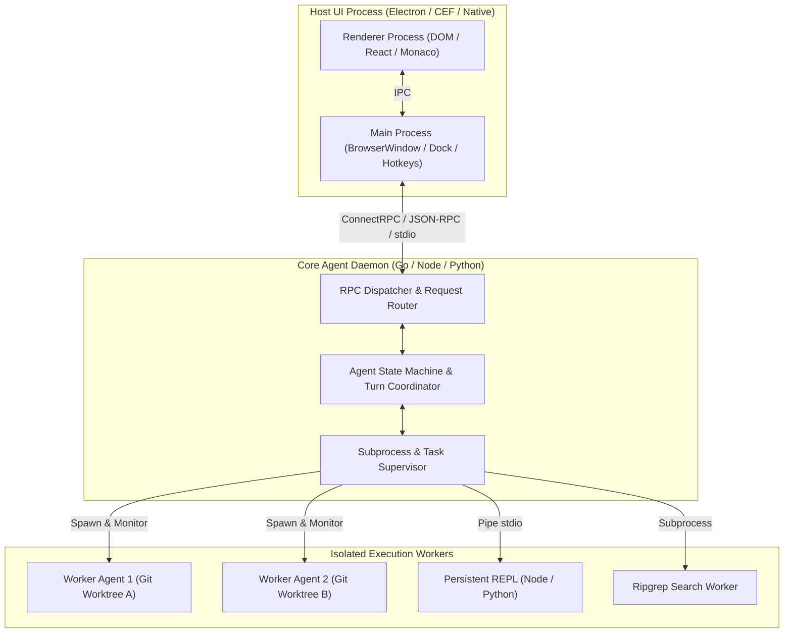
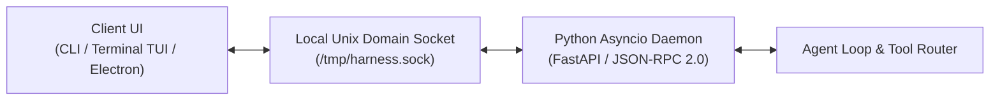

# 01: System Topology & Engine Design
*Multi-Process Host Architecture, Daemon Supervision, and Core Runtime Lifecycle*

---

## 1. High-Level System Topology

Modern agent harnesses avoid running heavy AI orchestration, tool execution, and workspace indexing directly inside the user interface thread. Both Antigravity and ChatGPT Desktop employ a **multi-process decoupling model**:



---

## 2. Reverse-Engineered Topologies

### A. Google Antigravity Topology
* **UI Layer**: Electron fork (VS Code core) stored in [`/Applications/Antigravity.app/Contents/Resources/app.asar`](file:///Applications/Antigravity.app/Contents/Resources/app.asar).
* **Agent Engine**: A standalone, compiled Go binary: [`/Applications/Antigravity.app/Contents/Resources/bin/language_server`](file:///Applications/Antigravity.app/Contents/Resources/bin/language_server) (151 MB Mach-O 64-bit arm64).
* **Inter-Process Channel**: The Electron UI launches `language_server` as a managed child process on application boot and communicates over local Unix domain sockets or HTTP/2 using **ConnectRPC** (`/exa.api_server_pb.ApiServerService/*`).
* **Concurrency**: Pure Go concurrency using goroutines and channels. Subagent tasks, background command monitors, and file watchers run concurrently in separate goroutines.
* **Benefits**:
  * Near-instant startup and minimal idle CPU footprint.
  * Native access to OS syscalls and robust child process supervision.
  * Crashes in the agent engine do not crash the user's active editor window.

### B. OpenAI ChatGPT Desktop Topology (Codex / Owl)
* **UI Layer**: Custom Chromium build (`Codex Framework.framework` v155) loading an Electron bundle ([`app.asar`](file:///Applications/ChatGPT.app/Contents/Resources/app.asar), 561 MB).
* **System Integration**: Native macOS Node.js addons (`.node` binaries in [`/Applications/ChatGPT.app/Contents/Resources/native`](file:///Applications/ChatGPT.app/Contents/Resources/native)):
  * `bare-modifier-monitor`: Low-level hook listening for Option+Space global hotkey.
  * `sky.node`: Native macOS Accessibility / ScreenCaptureKit bridge.
  * `system-audio-spectrum`: FFT real-time audio visualization.
* **Tool / REPL Engine**: Dedicated Node.js instance ([`cua_node/bin/node`](file:///Applications/ChatGPT.app/Contents/Resources/cua_node/bin/node) and [`node_repl`](file:///Applications/ChatGPT.app/Contents/Resources/cua_node/bin/node_repl)).
* **Benefits**:
  * Unified JavaScript/TypeScript runtime across UI, plugins, and execution environments.
  * Seamless native module bridging (`N-API`) for macOS system hooks.

---

## 3. Custom Harness Target Topology

For your custom harness, you have two optimal paths depending on your primary language:

### Option A: Python Core Daemon (Recommended for Hermes Agent)
If you are extending Hermes, Python 3.11+ with `asyncio` is the natural choice:



#### Core Components to Build:
1. **`harness_daemon.py`**:
   * Initializes the event loop.
   * Binds to a local Unix socket (`~/.custom_harness/harness.sock`) or loopback TCP port (`127.0.0.1:8765`).
   * Handles client connection lifecycles and multiplexes events.
2. **`supervisor.py`**:
   * Launches background tasks using `asyncio.create_subprocess_exec`.
   * Manages stdout/stderr streaming buffers without blocking the main event loop.
   * Tracks PID lifecycles and handles clean SIGTERM/SIGKILL termination.
3. **`session_manager.py`**:
   * Maintains active conversations, conversation trees, and child subagent states.

---

## 4. Daemon Supervision & Crash Recovery Pattern

A critical resilience requirement discovered in both Antigravity and ChatGPT is **crash isolation**. The agent harness daemon must survive tool failures and provide recovery points:

```python
"""
daemon_supervisor.py - Process Supervisor for Custom Agent Harness
Manages daemon lifecycle, signals, and child process containment.
"""
import asyncio
import os
import signal
import sys
from pathlib import Path

class DaemonSupervisor:
    def __init__(self, socket_path: Path):
        self.socket_path = socket_path
        self._running = False
        self._active_tasks: dict[str, asyncio.subprocess.Process] = {}

    async def start(self):
        self._running = True
        # Setup signal handlers for graceful shutdown
        loop = asyncio.get_running_loop()
        for sig in (signal.SIGINT, signal.SIGTERM):
            loop.add_signal_handler(sig, lambda s=sig: asyncio.create_task(self.shutdown(s)))

        # Clean old socket
        if self.socket_path.exists():
            self.socket_path.unlink()

        server = await asyncio.start_unix_server(self._handle_client, path=str(self.socket_path))
        print(f"Daemon listening on {self.socket_path} (PID: {os.getpid()})")
        async with server:
            await server.serve_forever()

    async def _handle_client(self, reader: asyncio.StreamReader, writer: asyncio.StreamWriter):
        while self._running:
            line = await reader.readline()
            if not line:
                break
            # Process incoming JSON-RPC frame
            response = await self._route_rpc(line.decode().strip())
            writer.write((response + "\n").encode())
            await writer.drain()
        writer.close()
        await writer.wait_closed()

    async def _route_rpc(self, payload: str) -> str:
        # Implemented in 02_IPC_PROTOCOLS_AND_EVENT_STREAMING.md
        return '{"jsonrpc": "2.0", "result": "acknowledged", "id": 1}'

    async def shutdown(self, sig):
        print(f"Received exit signal {sig.name}. Terminating active child tasks...")
        self._running = False
        for task_id, proc in list(self._active_tasks.items()):
            try:
                proc.terminate()
                await proc.wait()
            except Exception:
                proc.kill()
        if self.socket_path.exists():
            self.socket_path.unlink()
        sys.exit(0)

if __name__ == "__main__":
    sock = Path.home() / ".custom_harness" / "daemon.sock"
    sock.parent.mkdir(parents=True, exist_ok=True)
    asyncio.run(DaemonSupervisor(sock).start())
```
