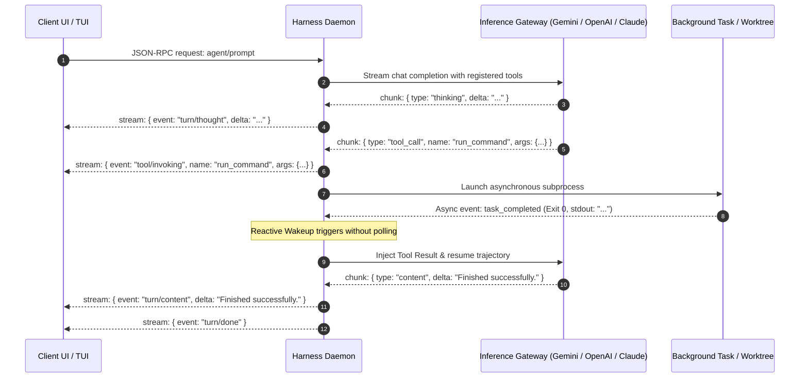

# 02: IPC Protocols & Event Streaming
*Wire Protocol Specifications, Streaming Framing, and Reactive Non-Polling Wakeups*

---

## 1. Protocol Architecture Overview

An agent harness requires bidirectional, multiplexed communication:
1. **Model to Daemon**: Streaming token deltas, reasoning chunks, and tool call requests.
2. **Daemon to Client UI**: Real-time rendering of markdown, diff updates, and interactive permission prompts.
3. **Execution Workers to Daemon**: Asynchronous completion events, stdout streaming, and process exit codes.



---

## 2. Reverse-Engineered Wire Protocols

### A. Antigravity: ConnectRPC (Buf Connect / gRPC-Web)
Antigravity utilizes **ConnectRPC** over HTTP/2 and Unix domain sockets.
Key RPC endpoints discovered in [`language_server`](file:///Applications/Antigravity.app/Contents/Resources/bin/language_server):
* `/exa.api_server_pb.ApiServerService/GetMQuery`: Fetches workspace index, symbol graph, and contextual snippets.
* `/exa.api_server_pb.ApiServerService/Subscribe`: Establishes a persistent bi-directional gRPC stream for file system watcher events and background task status.
* `/exa.remoting.RemotingService/RespondToPrompt`: Streams model responses, tool calls, and UI state diffs.

### B. ChatGPT Desktop: Server-Sent Events (SSE) & Electron IPC
ChatGPT streams structured JSON objects using Server-Sent Events (`text/event-stream`):
* `event: conversation.item.created`: New message frame allocated in conversation history.
* `event: response.text.delta`: Streamed text token.
* `event: response.function_call_arguments.delta`: Streaming partial JSON arguments for tools.
* `event: response.output_item.done`: Signals completion of tool call or assistant turn.

---

## 3. Custom Harness Wire Protocol Specification (JSON-RPC 2.0 Streaming)

To avoid proprietary Protobuf schemas while maintaining high speed and simplicity, the custom harness uses line-delimited JSON-RPC 2.0 frames over Unix Sockets or stdio.

### Frame Schemas

#### 1. Client `turn/start` Request
```json
{
  "jsonrpc": "2.0",
  "id": "req-101",
  "method": "turn/start",
  "params": {
    "conversation_id": "conv-uuid-42",
    "prompt": "Inspect the repository and refactor the auth middleware",
    "workspace_path": "/path/to/project",
    "model": "gpt-6.1-sol"
  }
}
```

#### 2. Daemon Streamed Notifications (`event`)
```json
{
  "jsonrpc": "2.0",
  "method": "turn/stream",
  "params": {
    "type": "thought",
    "delta": "Checking directory structure for auth handlers..."
  }
}
```

```json
{
  "jsonrpc": "2.0",
  "method": "turn/tool_call",
  "params": {
    "call_id": "call-abc123",
    "name": "run_command",
    "arguments": {
      "CommandLine": "git status",
      "Cwd": "/path/to/project"
    }
  }
}
```

```json
{
  "jsonrpc": "2.0",
  "method": "turn/tool_result",
  "params": {
    "call_id": "call-abc123",
    "name": "run_command",
    "status": "success",
    "output": "On branch main\nnothing to commit, working tree clean"
  }
}
```

```json
{
  "jsonrpc": "2.0",
  "method": "turn/done",
  "params": {
    "conversation_id": "conv-uuid-42",
    "metrics": {
      "input_tokens": 1420,
      "output_tokens": 380,
      "wall_time_ms": 2840
    }
  }
}
```

---

## 4. The Reactive Wakeup Mechanism (Zero-Polling Engine)

A critical limitation in amateur agent loops is **polling** (`while is_running: sleep(1)`).
Both Antigravity and Hermes use **event-driven reactive wakeup**:
* When a tool (like `run_command` or `invoke_subagent`) runs asynchronously, the main turn transitions to `SUSPENDED_WAITING_FOR_EVENTS`.
* The thread consumes 0% CPU.
* Completion of the child process or reception of a peer subagent message immediately signals an internal `asyncio.Event` or Go `channel`, triggering the planner turn instantly.

### Clean-Room Python Implementation

```python
"""
reactive_event_loop.py - Zero-Polling Reactive Turn Coordinator
Manages agent execution state with event-driven reactive wakeup.
"""
import asyncio
from dataclasses import dataclass, field
from enum import Enum
from typing import Any

class AgentState(Enum):
    IDLE = "idle"
    PLANNING = "planning"
    EXECUTING_TOOLS = "executing_tools"
    SUSPENDED_WAITING = "suspended_waiting"
    TERMINATED = "terminated"

@dataclass
class EventMessage:
    sender_id: str
    event_type: str
    payload: Any

class ReactiveTurnCoordinator:
    def __init__(self, conversation_id: str):
        self.conversation_id = conversation_id
        self.state = AgentState.IDLE
        self._inbox: asyncio.Queue[EventMessage] = asyncio.Queue()
        self._pending_tasks: dict[str, asyncio.Task] = {}

    async def enqueue_incoming_event(self, event: EventMessage):
        """Called by background tasks or child subagents upon completion."""
        await self._inbox.put(event)

    async def execute_turn_loop(self, user_prompt: str):
        self.state = AgentState.PLANNING
        print(f"[{self.conversation_id}] Starting turn with prompt: {user_prompt}")

        while self.state != AgentState.TERMINATED:
            if self.state == AgentState.PLANNING:
                # 1. Query LLM with current transcript and pending events
                tool_calls = await self._mock_call_llm()

                if not tool_calls:
                    # No more tools needed; turn complete
                    self.state = AgentState.IDLE
                    print(f"[{self.conversation_id}] Turn finished cleanly.")
                    break

                # 2. Launch tools (some sync, some background async)
                self.state = AgentState.EXECUTING_TOOLS
                has_async_tasks = await self._dispatch_tools(tool_calls)

                if has_async_tasks:
                    # 3. Enter zero-polling reactive sleep
                    self.state = AgentState.SUSPENDED_WAITING
                    print(f"[{self.conversation_id}] Entering reactive sleep. 0% CPU consumption.")

            elif self.state == AgentState.SUSPENDED_WAITING:
                # Blocks efficiently until ANY background worker pushes to inbox
                wake_event = await self._inbox.get()
                print(f"[{self.conversation_id}] Reactive wakeup triggered by {wake_event.sender_id} ({wake_event.event_type})")
                self._inbox.task_done()
                
                # Resume planning state with new information
                self.state = AgentState.PLANNING

    async def _dispatch_tools(self, tool_calls: list[dict]) -> bool:
        has_async = False
        for call in tool_calls:
            task_id = call["id"]
            if call.get("is_background", False):
                # Spawn background supervisor task
                bg_task = asyncio.create_task(self._run_background_worker(task_id, call["command"]))
                self._pending_tasks[task_id] = bg_task
                has_async = True
            else:
                # Synchronous tool execution
                print(f"Executing synchronous tool {call['name']}...")
        return has_async

    async def _run_background_worker(self, task_id: str, command: str):
        """Simulates background process that pushes to coordinator inbox on finish."""
        await asyncio.sleep(2.0) # Simulating long build or test command
        await self.enqueue_incoming_event(
            EventMessage(sender_id=task_id, event_type="TASK_COMPLETED", payload={"exit_code": 0, "output": "Tests passed."})
        )

    async def _mock_call_llm(self) -> list[dict]:
        # Simulating one background tool invocation
        if not hasattr(self, "_already_called"):
            self._already_called = True
            return [{"id": "task-test-runner", "name": "run_command", "command": "pytest", "is_background": True}]
        return []

if __name__ == "__main__":
    coordinator = ReactiveTurnCoordinator("test-session-001")
    asyncio.run(coordinator.execute_turn_loop("Run all test suites in background"))
```
