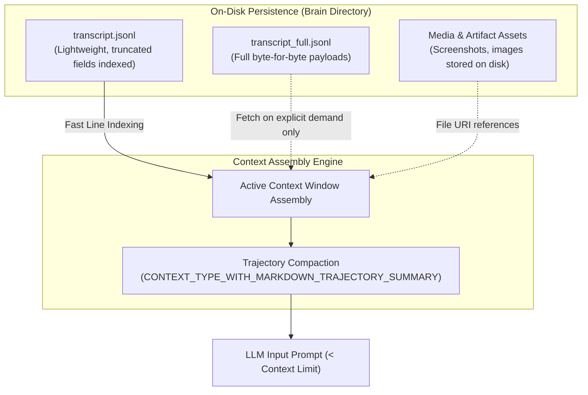

# 03: Context Engine & Transcript Storage
*Transcript Schema, Pointer Truncation, and Trajectory Compaction Algorithms*

---

## 1. The Context Explosion Problem

In complex coding agent sessions, conversational transcripts rapidly grow into hundreds of thousands of tokens due to:
* Verbose terminal outputs (compiler logs, test runs).
* Large file views (`view_file` dumping hundreds of lines).
* Detailed model thinking and chain-of-thought traces.

Both Antigravity and ChatGPT employ **Tiered Persistence & Pointer Truncation** to maintain responsive prompt generation without losing historical provenance.



---

## 2. Reverse-Engineered Transcript Schema

Antigravity stores sessions under `~/.gemini/antigravity/brain/<conversation-id>/.system_generated/logs/`:
* `transcript.jsonl`: Fast, compact log.
* `transcript_full.jsonl`: Full archive.

### Line Schema Specification (JSONL)

Each line in `transcript.jsonl` is a self-contained JSON object:

```json
{
  "step_index": 142,
  "source": "MODEL",
  "type": "PLANNER_RESPONSE",
  "status": "DONE",
  "created_at": "2026-10-12T15:03:04+02:00",
  "content": "I will inspect the server implementation...",
  "thinking": "The user wants to refactor the socket listener...",
  "tool_calls": [
    {
      "id": "call-091",
      "name": "view_file",
      "arguments": {
        "AbsolutePath": "/Users/brightech/project/server.py",
        "StartLine": 1,
        "EndLine": 50
      }
    }
  ],
  "truncated_fields": ["thinking", "content"]
}
```

### Key Schema Properties
1. **`truncated_fields` Array**:
   * If a field (`content`, `thinking`, or `tool_calls`) exceeds a token threshold (e.g. 1,000 characters), it is truncated in `transcript.jsonl` and recorded in `truncated_fields`.
   * When the agent needs the exact unshortened content, it reads only the specific line index from `transcript_full.jsonl`.
2. **Media Decoupling**:
   * Screenshots and images are **never** stored as base64 strings in the JSON transcript.
   * They are written to disk as PNG/WebP files, and referenced via a file URI:
     `{"media": [{"mime_type": "image/png", "uri": "file:///path/to/screenshot.png"}]}`.

---

## 3. Trajectory Compaction Engine

Discovered in Antigravity's Go `language_server` binary:
`CONTEXT_TYPE_WITH_MARKDOWN_TRAJECTORY_SUMMARY`

When conversation history approaches token capacity (e.g., 80% of context window), the engine compresses preceding turns into a structured markdown summary while preserving the initial user intent and latest working turns.

### Markdown Compaction Structure
```markdown
<CONTEXT_SUMMARY>
# Task Overview
- Primary Goal: Rebuild auth middleware to support OAuth2 tokens.

# Completed Steps
- Inspected /src/auth.py and identified deprecated HMAC validation.
- Created unit test suite in /tests/test_auth.py.

# Active Context & Key Findings
- Current test failure: Token expiration timestamp check fails due to UTC offset.
- Target file: /src/auth.py (Lines 45-80).

# Open Decisions & Commitments
- User approved switching to datetime.timezone.utc.
</CONTEXT_SUMMARY>
```

---

## 4. Custom Harness Implementation

```python
"""
transcript_engine.py - High-Performance Tiered Transcript Manager
Handles compact vs full log persistence, truncation pointers, and compaction.
"""
import json
from pathlib import Path
from typing import Any

class TranscriptEngine:
    def __init__(self, session_dir: Path, truncation_threshold: int = 1500):
        self.session_dir = session_dir
        self.session_dir.mkdir(parents=True, exist_ok=True)
        self.compact_file = session_dir / "transcript.jsonl"
        self.full_file = session_dir / "transcript_full.jsonl"
        self.truncation_threshold = truncation_threshold
        self.step_counter = 0

    def append_step(
        self,
        source: str,
        step_type: str,
        content: str | None = None,
        thinking: str | None = None,
        tool_calls: list[dict] | None = None,
        media: list[dict] | None = None
    ) -> int:
        self.step_counter += 1
        
        full_record = {
            "step_index": self.step_counter,
            "source": source,
            "type": step_type,
            "content": content or "",
            "thinking": thinking or "",
            "tool_calls": tool_calls or [],
            "media": media or []
        }

        # 1. Write full record
        with open(self.full_file, "a", encoding="utf-8") as f:
            f.write(json.dumps(full_record) + "\n")

        # 2. Build compact record with pointer truncation
        compact_record = dict(full_record)
        truncated_fields = []

        if len(compact_record["content"]) > self.truncation_threshold:
            compact_record["content"] = compact_record["content"][:self.truncation_threshold] + "... [TRUNCATED]"
            truncated_fields.append("content")

        if len(compact_record["thinking"]) > self.truncation_threshold:
            compact_record["thinking"] = compact_record["thinking"][:self.truncation_threshold] + "... [TRUNCATED]"
            truncated_fields.append("thinking")

        if truncated_fields:
            compact_record["truncated_fields"] = truncated_fields

        with open(self.compact_file, "a", encoding="utf-8") as f:
            f.write(json.dumps(compact_record) + "\n")

        return self.step_counter

    def load_compact_history(self) -> list[dict]:
        if not self.compact_file.exists():
            return []
        records = []
        with open(self.compact_file, "r", encoding="utf-8") as f:
            for line in f:
                if line.strip():
                    records.append(json.loads(line))
        return records

    def fetch_full_field(self, step_index: int, field_name: str) -> Any:
        """Reads specific line from transcript_full.jsonl when truncated."""
        with open(self.full_file, "r", encoding="utf-8") as f:
            for line in f:
                record = json.loads(line)
                if record.get("step_index") == step_index:
                    return record.get(field_name)
        return None
```
