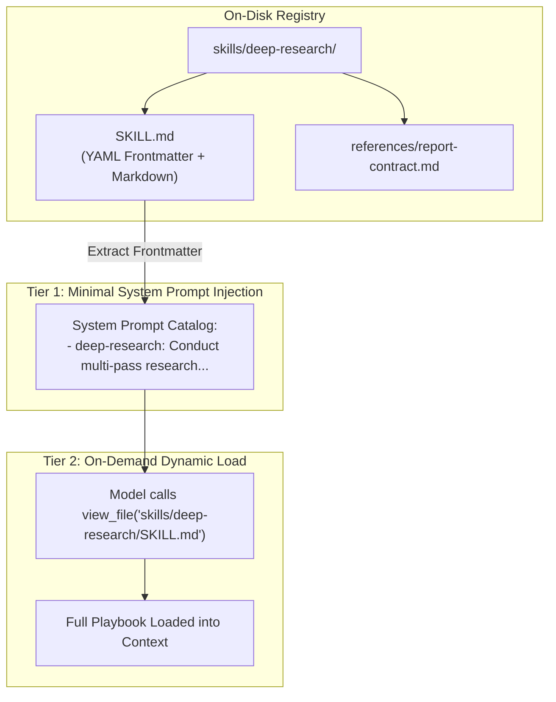

# 04: Progressive Skills & Plugin System
*Specification for SKILL.md, Plugin Manifests (.codex-plugin), and Progressive Disclosure*

---

## 1. The Progressive Disclosure Philosophy

Loading dozens of complex tools and full instructions directly into an agent's initial prompt causes severe issues:
* Wasted context tokens (cost and latency).
* Reduced instruction-following adherence (prompt distraction).
* Ambiguity in tool selection.

Both Google Antigravity and OpenAI ChatGPT Desktop have adopted the **Progressive Disclosure Pattern**:
1. **Tier 1 (Catalog Registration)**: Only the skill's name and high-level description are injected into the system prompt (~50 tokens per skill).
2. **Tier 2 (On-Demand Activation)**: The agent autonomously uses `view_file` to read the full `SKILL.md` playbook only when a task matches the skill's trigger conditions.
3. **Tier 3 (Companion Assets)**: Reference documentation, helper scripts, and prompt templates located in the skill directory are loaded on-demand.



---

## 2. Reverse-Engineered Plugin & Skill Schemas

### A. OpenAI ChatGPT Desktop Plugin Manifest (`plugin.json`)
Located at `/Applications/Codex.app/Contents/Resources/plugins/openai-bundled/plugins/*/.codex-plugin/plugin.json`:

```json
{
  "name": "deep-research",
  "version": "0.1.1",
  "description": "Conduct multi-pass, source-backed research and deliver a cited, visually verified DOCX report.",
  "author": {
    "name": "OpenAI",
    "email": "support@openai.com",
    "url": "https://openai.com/"
  },
  "license": "Proprietary",
  "keywords": ["research", "deep research", "web research", "citations", "docx"],
  "skills": "./skills/",
  "interface": {
    "displayName": "Deep Research",
    "shortDescription": "Research and create DOCX files",
    "longDescription": "Investigate complex questions through broad discovery, targeted follow-up, and evidence-backed synthesis.",
    "category": "Research",
    "capabilities": ["Interactive", "Read", "Write"],
    "composerIcon": "./assets/deep-research.svg",
    "brandColor": "#4F46E5",
    "defaultPrompt": [
      "Run deep research at xhigh with a dedicated subagent and deliver a cited DOCX report.",
      "Compare these options using current primary sources in a DOCX report."
    ]
  }
}
```

### B. Standard `SKILL.md` File Contract
Used identically across Antigravity and ChatGPT:

```markdown
---
name: reference-video-teardown
description: Analyze reference video recordings, extract keyframe contact sheets, and compare animation timing against product goals. Trigger when analyzing video, animations, or UI motion.
---

# Video Teardown Playbook

## Execution Steps
1. Probe duration and resolution using ffmpeg / ffprobe.
2. Generate coarse keyframes (1 every 15-30 seconds) into a contact sheet.
3. Transcribe audio segments using Whisper ASR.
4. Synthesize visual motion and audio cues into comparative analysis.
```

---

## 3. Discovery Roots & Precedence Hierarchy

In your custom harness, discover skills across three standard precedence tiers:
1. **Workspace Skills** (Highest Priority): `<active-workspace>/.harness/skills/*`
2. **User Global Skills**: `~/.custom_harness/skills/*`
3. **Built-in System Skills** (Lowest Priority): `<harness-install-dir>/builtin/skills/*`

If a skill with the same `name` exists in multiple tiers, the higher tier overrides the lower tier.

---

## 4. Custom Harness Implementation

```python
"""
plugin_and_skill_loader.py - Progressive Skill & Plugin Discovery Engine
Scans multi-tier skill roots, extracts YAML metadata, and formats system prompt catalogs.
"""
from dataclasses import dataclass
from pathlib import Path
import json
import re
import yaml

@dataclass
class Skill:
    name: str
    description: str
    path: Path
    tier: str # 'workspace', 'user', or 'builtin'

class PluginManager:
    def __init__(self, workspace_root: Path | None = None):
        self.workspace_root = workspace_root
        self.user_root = Path.home() / ".custom_harness" / "skills"
        self.builtin_root = Path(__file__).parent / "builtin" / "skills"
        self.skills: dict[str, Skill] = {}

    def discover_all(self):
        self.skills.clear()
        # Scan in increasing order of priority
        self._scan_directory(self.builtin_root, "builtin")
        self._scan_directory(self.user_root, "user")
        if self.workspace_root and (self.workspace_root / ".harness" / "skills").exists():
            self._scan_directory(self.workspace_root / ".harness" / "skills", "workspace")

    def _scan_directory(self, base_dir: Path, tier: str):
        if not base_dir.exists():
            return
        for skill_file in base_dir.glob("**/SKILL.md"):
            try:
                content = skill_file.read_text(encoding="utf-8")
                match = re.match(r"^---\n(.*?)\n---", content, re.DOTALL)
                if match:
                    frontmatter = yaml.safe_load(match.group(1))
                    name = frontmatter.get("name")
                    desc = frontmatter.get("description", "").strip()
                    if name and desc:
                        # Higher tiers overwrite lower tiers
                        self.skills[name] = Skill(name=name, description=desc, path=skill_file, tier=tier)
            except Exception as e:
                print(f"Error parsing skill {skill_file}: {e}")

    def render_system_prompt_skills_catalog(self) -> str:
        if not self.skills:
            return ""
        lines = [
            "<skills>",
            "You have access to specialized skills. Each skill contains detailed playbooks in SKILL.md.",
            "If a skill seems relevant to your current task, you MUST read its SKILL.md using `view_file` before proceeding.",
            "",
            "Available skills:"
        ]
        for name, skill in sorted(self.skills.items()):
            lines.append(f"- {name} ({skill.path}): {skill.description}")
        lines.append("</skills>")
        return "\n".join(lines)
```
