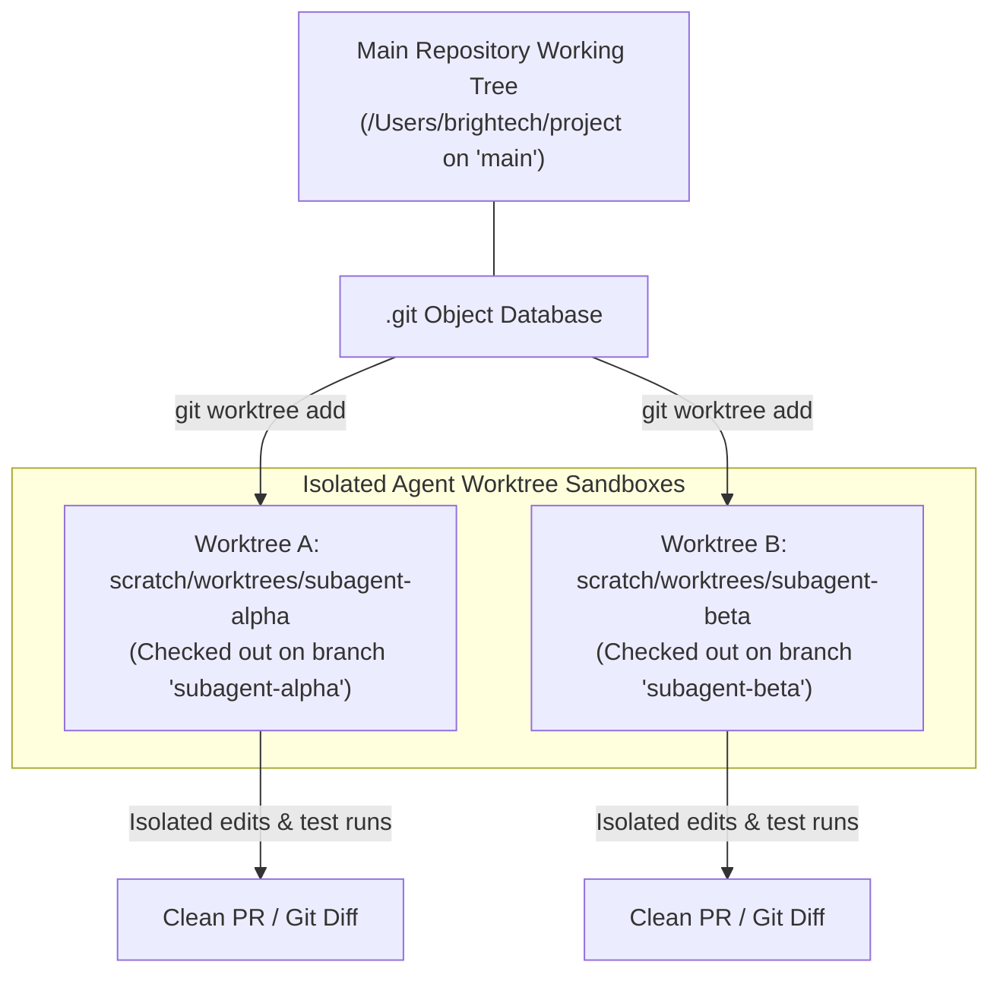

# 05: Execution Sandbox & Git Worktrees
*Subagent Worktree Isolation, Terminal Virtualization, and Background Task Supervision*

---

## 1. The Multi-Agent Collision Problem

When multiple autonomous subagents operate concurrently on a shared repository, standard file edits create severe race conditions:
* Agent B overwrites an uncommitted edit made by Agent A.
* Git index locks (`.git/index.lock`) cause commands to fail.
* Compilers and tests fail due to partially written intermediate states.

Antigravity solves this with **Git Worktree Isolation**.



---

## 2. Reverse-Engineered Worktree Lifecycle

Discovered in Antigravity's Go `language_server` binary:
* `git restore --worktree failed: %w, output: %s`
* `failed to get local path for new git worktree`
* `failed to restore workspace %s from backup %s`
* `KillSubagent: failed to update summary for %s`

### Worktree Protocol Contract
1. **Provisioning**: When `invoke_subagent` is called with `Workspace: "branch"`, the orchestrator executes:
   ```bash
   git -C /path/to/repo worktree add /path/to/scratch/subagent-101 -b agent-branch-101
   ```
2. **Execution**: The subagent executes all file views, edits, and terminal commands strictly with `Cwd=/path/to/scratch/subagent-101`.
3. **Reconciliation**: When the subagent finishes:
   * The parent reviews `git diff main..agent-branch-101`.
   * If approved, it merges or fast-forwards.
4. **Teardown**: The worktree is pruned cleanly without touching the main repo:
   ```bash
   git -C /path/to/repo worktree remove --force /path/to/scratch/subagent-101
   ```

---

## 3. Terminal Execution Sandbox & Environment Guardrails

Running terminal commands safely requires specific environment sanitization:
1. **Pager Neutralization**: Always export `PAGER=cat` and `GIT_PAGER=cat` to prevent git or system utilities from blocking on interactive pagers (`less`).
2. **Execution Timeouts & Async Transition**:
   * Commands specify `WaitMsBeforeAsync` (e.g. 5,000 ms).
   * If the command terminates within 5 seconds, it returns synchronously.
   * If it continues running (e.g. dev server, build, long test suite), it transitions cleanly to a **Background Task** and returns a `task_id` without freezing the agent.
3. **Environment Sanitization**:
   * Strip sensitive tokens (`GITHUB_TOKEN`, internal secrets) unless explicitly whitelisted in a secure credential store.

---

## 4. Custom Harness Implementation

```python
"""
worktree_sandbox.py - Subagent Isolation and Worktree Lifecycle Manager
"""
import asyncio
import os
import shutil
import subprocess
from pathlib import Path

class WorktreeManager:
    def __init__(self, repo_root: Path, worktree_base_dir: Path):
        self.repo_root = repo_root
        self.worktree_base = worktree_base_dir
        self.worktree_base.mkdir(parents=True, exist_ok=True)
        self._active_worktrees: dict[str, Path] = {}

    def create_worktree(self, subagent_id: str) -> Path:
        target_dir = self.worktree_base / f"worker_{subagent_id}"
        branch_name = f"harness_worker_{subagent_id}"

        if target_dir.exists():
            shutil.rmtree(target_dir)

        # git worktree add <dir> -b <branch>
        cmd = ["git", "-C", str(self.repo_root), "worktree", "add", str(target_dir), "-b", branch_name]
        res = subprocess.run(cmd, capture_output=True, text=True)
        if res.returncode != 0:
            raise RuntimeError(f"Failed to create worktree: {res.stderr}")

        self._active_worktrees[subagent_id] = target_dir
        return target_dir

    def remove_worktree(self, subagent_id: str, delete_branch: bool = True):
        target_dir = self._active_worktrees.get(subagent_id)
        if not target_dir or not target_dir.exists():
            return

        cmd = ["git", "-C", str(self.repo_root), "worktree", "remove", "--force", str(target_dir)]
        subprocess.run(cmd, capture_output=True, text=True)

        if delete_branch:
            subprocess.run(["git", "-C", str(self.repo_root), "branch", "-D", f"harness_worker_{subagent_id}"], capture_output=True)

        self._active_worktrees.pop(subagent_id, None)

class CommandExecutor:
    @staticmethod
    async def run(command: str, cwd: Path, timeout_seconds: float = 30.0) -> dict:
        env = dict(os.environ)
        env["PAGER"] = "cat"
        env["GIT_PAGER"] = "cat"

        proc = await asyncio.create_subprocess_shell(
            command,
            cwd=str(cwd),
            env=env,
            stdout=asyncio.subprocess.PIPE,
            stderr=asyncio.subprocess.PIPE
        )

        try:
            stdout, stderr = await asyncio.wait_for(proc.communicate(), timeout=timeout_seconds)
            return {
                "status": "completed",
                "exit_code": proc.returncode,
                "stdout": stdout.decode("utf-8", errors="replace"),
                "stderr": stderr.decode("utf-8", errors="replace")
            }
        except asyncio.TimeoutError:
            proc.kill()
            return {"status": "timeout", "exit_code": -1, "stdout": "", "stderr": "Command timed out."}
```
