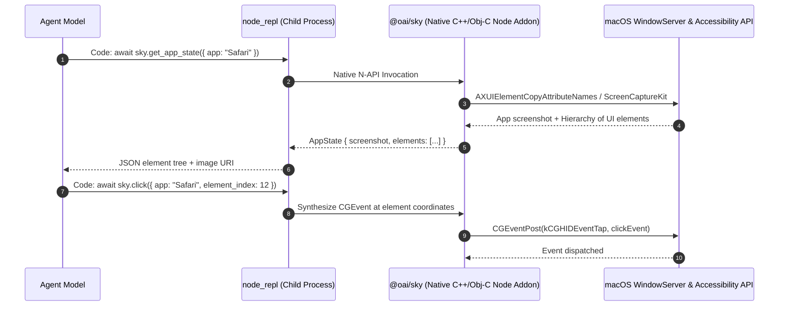

# 06: Computer Use & Desktop Integration
*Reverse-Engineered @oai/sky API, macOS Accessibility Architecture, and Persistent REPL Execution*

---

## 1. Computer Use Architectural Overview

OpenAI's macOS Desktop Computer Use does not rely on fragile pixel-only clicking or heavy VM wrappers. Instead, it combines **macOS Accessibility Trees (AXUIElement)** with **ScreenCaptureKit** and an interactive **Node.js REPL**:



---

## 2. Reverse-Engineered `@oai/sky` API Surface

Extracted directly from ChatGPT's bundled plugin:
`/Applications/Codex.app/Contents/Resources/plugins/openai-bundled/plugins/computer-use/skills/computer-use/SKILL.md`

### TypeScript Type Contract
```typescript
type Sky = {
  target: "mac";
  
  // Element inspection and system discovery
  list_apps: () => Promise<Array<App>>;
  get_app_state: (args: { app: string; disableDiff?: boolean }) => Promise<AppState>;
  
  // Pointer actions
  click: (args: { 
    app: string; 
    element_index?: number; 
    x?: number; 
    y?: number; 
    mouse_button?: "left" | "right" | "middle"; 
    click_count?: number; 
    key?: string; 
    duration?: number 
  }) => Promise<void>;
  
  drag: (args: { app: string; from_x: number; from_y: number; to_x: number; to_y: number }) => Promise<void>;
  scroll: (args: { app: string; element_index?: number; x?: number; y?: number; direction: "up" | "down" | "left" | "right"; pages?: number }) => Promise<void>;

  // Keyboard and text input
  type_text: (args: { app: string; text: string }) => Promise<void>;
  paste: (args: { app: string; text: string; format: "text" | "md" | "html" }) => Promise<void>;
  press_key: (args: { app: string; key: string; duration?: number }) => Promise<void>;
  
  // High-level element value setting
  set_value: (args: { app: string; element_index: number; value: string }) => Promise<void>;
  select_text: (args: { app: string; element_index: number; text: string; prefix?: string; suffix?: string }) => Promise<void>;
  perform_secondary_action: (args: { app: string; element_index: number; action: string }) => Promise<void>;
};

type App = {
  id: string;
  displayName?: string;
  isRunning?: boolean;
};

type AppState = {
  app: string;
  screenshot: { uri: string; width: number; height: number } | null;
  elements: Array<{
    index: number;
    role: string;          // e.g. "AXButton", "AXTextField"
    title?: string;
    value?: string;
    bounds: { x: number; y: number; width: number; height: number };
    is_clickable: boolean;
  }>;
};
```

---

## 3. Persistent REPL Execution Model

ChatGPT runs a dedicated child process: `cua_node/bin/node_repl`.
* State is persistent across turns. Variables defined in turn 1 (`const myDoc = ...`) remain in scope in turn 2.
* Before executing commands, the environment bootstraps:
  ```javascript
  globalThis.sky = (await import("@oai/sky")).sky;
  ```
* Output is written back via `nodeRepl.write(JSON.stringify(result))`.

---

## 4. Custom Harness Implementation (Python / PyObjC)

You can replicate `@oai/sky` natively on macOS in Python using `PyObjC` without proprietary dependencies:

```python
"""
mac_desktop_bridge.py - Native macOS Accessibility and Screen Capture Engine
Implements clean-room equivalent of @oai/sky using ApplicationServices & Quartz.
"""
import subprocess
from dataclasses import dataclass
from pathlib import Path
import Quartz
from ApplicationServices import (
    AXUIElementCreateApplication,
    AXUIElementCopyAttributeValue,
    kAXWindowsAttribute,
    kAXChildrenAttribute,
    kAXRoleAttribute,
    kAXTitleAttribute,
    kAXPositionAttribute,
    kAXSizeAttribute
)
from AppKit import NSWorkspace

@dataclass
class UIElement:
    index: int
    role: str
    title: str
    bounds: tuple[float, float, float, float]

class MacDesktopBridge:
    def __init__(self, scratch_dir: Path):
        self.scratch_dir = scratch_dir
        self.scratch_dir.mkdir(parents=True, exist_ok=True)

    def list_running_apps(self) -> list[dict]:
        workspace = NSWorkspace.sharedWorkspace()
        apps = workspace.runningApplications()
        return [
            {"id": app.bundleIdentifier(), "displayName": app.localizedName(), "pid": app.processIdentifier()}
            for app in apps if app.activationPolicy() == 0 # regular UI apps
        ]

    def capture_screenshot(self, filename: str = "screen.png") -> Path:
        out_path = self.scratch_dir / filename
        # Fast macOS native screencapture
        subprocess.run(["screencapture", "-x", "-m", str(out_path)], check=True)
        return out_path

    def click(self, x: float, y: float):
        """Synthesize low-level Quartz mouse click."""
        point = Quartz.CGPoint(x, y)
        down = Quartz.CGEventCreateMouseEvent(None, Quartz.kCGEventLeftMouseDown, point, Quartz.kCGMouseButtonLeft)
        up = Quartz.CGEventCreateMouseEvent(None, Quartz.kCGEventLeftMouseUp, point, Quartz.kCGMouseButtonLeft)
        Quartz.CGEventPost(Quartz.kCGHIDEventTap, down)
        Quartz.CGEventPost(Quartz.kCGHIDEventTap, up)

    def type_text(self, text: str):
        """Synthesize keyboard typing."""
        for char in text:
            event = Quartz.CGEventCreateKeyboardEvent(None, 0, True)
            Quartz.CGEventKeyboardSetUnicodeString(event, len(char), char)
            Quartz.CGEventPost(Quartz.kCGHIDEventTap, event)
            up_event = Quartz.CGEventCreateKeyboardEvent(None, 0, False)
            Quartz.CGEventPost(Quartz.kCGHIDEventTap, up_event)
```
