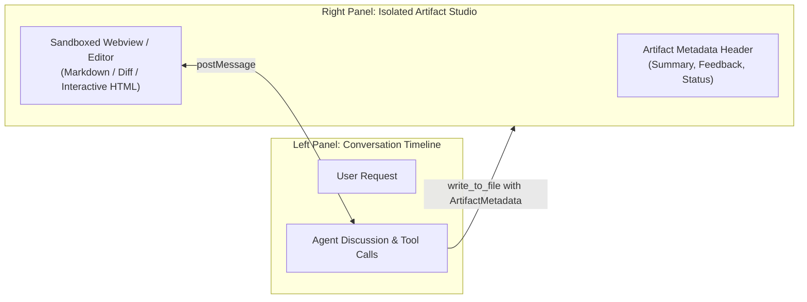

# 07: Generative UI & Artifact System
*Artifact Protocol, Sandboxed Webview Rendering, and Live Diff Presentation*

---

## 1. Architectural Role of Artifacts

In standard chat assistants, code, documentation, and diagrams are intermingled in a single scrolling timeline, leading to:
* Difficulties in reviewing large documents.
* Inability to test interactive UI prototypes directly in the window.
* Context pollution when updating intermediate revisions.

Both Antigravity and ChatGPT Desktop decouple rich deliverables into an **Artifact & Generative UI Panel**:



---

## 2. Reverse-Engineered Artifact Contracts

### A. Antigravity Artifact Metadata Contract
When writing files to `<appDataDir>/brain/<conversation-id>/`:

```json
{
  "ArtifactMetadata": {
    "Summary": "Comprehensive architecture specification and database schema...",
    "UserFacing": true,
    "RequestFeedback": true
  }
}
```
* **`UserFacing: true`**: Signals the UI to immediately slide open the right-side artifact viewer and focus this document.
* **`RequestFeedback: true`**: Renders an interactive action bar above the document with "Proceed" and "Request Changes" buttons that block agent turns until user interaction.
* **Isolated File System Path**: All artifacts persist directly in the conversation brain folder on disk, ensuring atomic versioning and offline persistence.

### B. Sandboxed Generative UI Webview
When generating interactive prototypes (HTML/CSS/JS or Three.js/WebGL canvas):
* The UI serves the file inside a sandboxed `<iframe>` with strict Content Security Policy (CSP):
  ```html
  <iframe 
    sandbox="allow-scripts allow-forms allow-same-origin" 
    src="vscode-webview://...">
  </iframe>
  ```
* Communication between the widget and the agent harness occurs strictly over `window.postMessage`.

---

## 3. Custom Harness Implementation

```python
"""
artifact_manager.py - Artifact Protocol and Webview Bridge
Manages persistence, metadata extraction, and HTML generation for the client UI.
"""
from dataclasses import dataclass
from pathlib import Path
import json

@dataclass
class ArtifactMetadata:
    summary: str
    user_facing: bool = True
    request_feedback: bool = False

class ArtifactManager:
    def __init__(self, brain_dir: Path):
        self.brain_dir = brain_dir
        self.brain_dir.mkdir(parents=True, exist_ok=True)
        self.manifest_file = self.brain_dir / "artifacts_manifest.json"

    def write_artifact(self, filename: str, content: str, metadata: ArtifactMetadata) -> Path:
        target_path = self.brain_dir / filename
        target_path.write_text(content, encoding="utf-8")

        # Update persistent manifest
        manifest = self._load_manifest()
        manifest[filename] = {
            "path": str(target_path),
            "summary": metadata.summary,
            "user_facing": metadata.user_facing,
            "request_feedback": metadata.request_feedback,
            "bytes": len(content.encode("utf-8"))
        }
        self.manifest_file.write_text(json.dumps(manifest, indent=2), encoding="utf-8")
        return target_path

    def render_sandboxed_html(self, raw_html: str) -> str:
        """Wraps interactive HTML widgets with a secure postMessage bridge."""
        bridge_script = """
        <script>
          window.addEventListener('message', (event) => {
            console.log('Received message from harness:', event.data);
          });
          function sendToHarness(type, payload) {
            window.parent.postMessage({ source: 'generative_ui', type, payload }, '*');
          }
        </script>
        """
        return f"<!DOCTYPE html><html><head>{bridge_script}</head><body>{raw_html}</body></html>"

    def _load_manifest(self) -> dict:
        if self.manifest_file.exists():
            return json.loads(self.manifest_file.read_text(encoding="utf-8"))
        return {}
```
