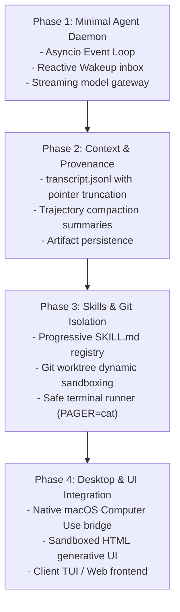

# 08: Build Blueprint & Starter Implementation
*Phased Roadmap, Architecture Scaffold, and Runnable End-to-End Proof of Concept*

---

## 1. Phased Implementation Roadmap

Building a complete custom harness is best achieved across four structured phases:



---

## 2. Directory Layout of the Custom Harness

```text
custom-agent-harness/
├── pyproject.toml
├── README.md
├── harness/
│   ├── __init__.py
│   ├── core/
│   │   ├── daemon.py              # Unix socket / stdio IPC server
│   │   ├── coordinator.py         # Reactive event loop & state machine
│   │   └── transcript.py          # Tiered JSONL logging & truncation
│   ├── skills/
│   │   ├── registry.py            # Progressive disclosure YAML parser
│   │   └── mcp_bridge.py          # Model Context Protocol client
│   ├── sandboxing/
│   │   ├── worktree.py            # Git worktree isolation per subagent
│   │   └── executor.py            # Safe shell command supervisor
│   ├── desktop/
│   │   └── macos_sky.py           # ScreenCaptureKit & Accessibility bridge
│   └── artifacts/
│       └── manager.py             # Generative UI & markdown artifact studio
└── builtin/
    └── skills/
        ├── deep-research/SKILL.md
        └── computer-use/SKILL.md
```

---

## 3. Complete Runnable Proof-of-Concept (`run_harness.py`)

This self-contained Python script integrates the **Reactive Event Loop**, **Progressive Skill Registry**, and **Tiered Transcript Engine** into a working harness:

```python
#!/usr/bin/env python3
"""
run_harness.py - Standalone Custom Agent Harness Engine
Demonstrates: Progressive Skills, Reactive Wakeup, and Tiered Transcripts.
"""
import asyncio
from dataclasses import dataclass
import json
from pathlib import Path
import re
import sys
import yaml

# ==========================================
# 1. Progressive Skill Registry
# ==========================================
@dataclass
class Skill:
    name: str
    description: str
    path: Path

class SkillRegistry:
    def __init__(self, root: Path):
        self.root = root
        self.skills: dict[str, Skill] = {}

    def scan(self):
        self.skills.clear()
        if not self.root.exists():
            return
        for file in self.root.glob("**/SKILL.md"):
            content = file.read_text(encoding="utf-8")
            match = re.match(r"^---\n(.*?)\n---", content, re.DOTALL)
            if match:
                meta = yaml.safe_load(match.group(1))
                name = meta.get("name")
                desc = meta.get("description", "").strip()
                if name:
                    self.skills[name] = Skill(name, desc, file)

    def render_catalog(self) -> str:
        lines = ["## Available Skills:"]
        for s in self.skills.values():
            lines.append(f"- **{s.name}**: {s.description} (Read via `view_skill('{s.name}')`)")
        return "\n".join(lines)

# ==========================================
# 2. Tiered Transcript Engine
# ==========================================
class TranscriptEngine:
    def __init__(self, session_dir: Path):
        self.session_dir = session_dir
        self.session_dir.mkdir(parents=True, exist_ok=True)
        self.compact_file = session_dir / "transcript.jsonl"
        self.full_file = session_dir / "transcript_full.jsonl"
        self.step = 0

    def log(self, source: str, step_type: str, content: str, tool_calls: list = None):
        self.step += 1
        record = {
            "step_index": self.step,
            "source": source,
            "type": step_type,
            "content": content,
            "tool_calls": tool_calls or []
        }
        with open(self.full_file, "a", encoding="utf-8") as f:
            f.write(json.dumps(record) + "\n")

        compact = dict(record)
        if len(compact["content"]) > 200:
            compact["content"] = compact["content"][:200] + "... [TRUNCATED]"
            compact["truncated_fields"] = ["content"]

        with open(self.compact_file, "a", encoding="utf-8") as f:
            f.write(json.dumps(compact) + "\n")

# ==========================================
# 3. Reactive Turn Coordinator
# ==========================================
class AgentCoordinator:
    def __init__(self, workspace: Path, session_dir: Path):
        self.workspace = workspace
        self.transcripts = TranscriptEngine(session_dir)
        self.skills = SkillRegistry(workspace / "skills")
        self.skills.scan()
        self.inbox = asyncio.Queue()

    async def execute_turn(self, user_prompt: str):
        print(f"\n[Turn Start] User: {user_prompt}")
        self.transcripts.log("USER", "USER_INPUT", user_prompt)

        # Assemble prompt with progressive skills catalog
        catalog = self.skills.render_catalog()
        print(f"[Engine] Injected {len(self.skills.skills)} skills progressively.")

        # Simulate Model Turn with an Asynchronous Task
        print("[Planner] Launching asynchronous background task...")
        self.transcripts.log("MODEL", "PLANNER_RESPONSE", "Executing background build test...", [
            {"name": "run_command", "args": {"cmd": "make test", "background": True}}
        ])

        # Spawn non-blocking background worker
        asyncio.create_task(self._background_worker("build-task-1", "make test"))

        # Zero-polling reactive wait
        print("[Engine] Coordinator entering reactive sleep (0% CPU)...")
        event = await self.inbox.get()
        print(f"[Reactive Wakeup] Event received from {event['task_id']} with code {event['code']}")
        self.inbox.task_done()

        # Follow-up turn
        final_response = f"Background task {event['task_id']} completed successfully. Output: {event['output']}"
        self.transcripts.log("MODEL", "PLANNER_RESPONSE", final_response)
        print(f"[Turn Complete] Model: {final_response}")

    async def _background_worker(self, task_id: str, cmd: str):
        await asyncio.sleep(1.5) # Simulating command execution
        await self.inbox.put({
            "task_id": task_id,
            "code": 0,
            "output": "All 42 test suites passed in 1.4s"
        })

# ==========================================
# 4. Entrypoint
# ==========================================
async def main():
    workspace = Path("/tmp/custom_harness_test")
    (workspace / "skills" / "video-teardown").mkdir(parents=True, exist_ok=True)
    
    # Write sample skill
    (workspace / "skills" / "video-teardown" / "SKILL.md").write_text(
        "---\nname: video-teardown\ndescription: Extract video contact sheets and analyze timing.\n---\n# Playbook...",
        encoding="utf-8"
    )

    coordinator = AgentCoordinator(workspace, workspace / "brain" / "session-01")
    await coordinator.execute_turn("Run the video analysis and test suite")

if __name__ == "__main__":
    asyncio.run(main())
```

---

## 4. Next Implementation Steps

1. **Set Active Workspace**: Create your project root under [`/Users/brightech/.gemini/antigravity/scratch/custom-agent-harness`](file:///Users/brightech/.gemini/antigravity/scratch/custom-agent-harness) and set it as your active workspace in your IDE or Hermes.
2. **Add MCP Client Adapter**: Integrate `@modelcontextprotocol/sdk` or Python's `mcp` library to connect standard tool servers (like filesystem, github, rea).
3. **Connect Desktop Automation**: Import [`mac_desktop_bridge.py`](file:///Users/brightech/.gemini/antigravity/scratch/custom-harness-specs/06_COMPUTER_USE_AND_DESKTOP_INTEGRATION.md) to enable native macOS screen capture and accessibility automation.
