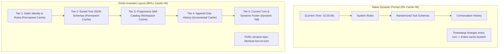

# 10: Prompt Caching & Prefix Invariance
*Maximizing Model Cache Hits (90%+), Deterministic Prefix Invariants, and Token Economics*

---

## 1. The Economics of Prompt Caching

Modern foundation models (Gemini 1.5/2.0, Claude 3.5, GPT-4o) employ **Prefix Prompt Caching**:
* **Cache Hits**: 50% to 90% reduction in token pricing and 3x to 5x faster Time-To-First-Token (TTFT).
* **The Strict Invariant**: Caching algorithms match strictly from token 0 forward. **A single modified character at the beginning of a prompt invalidates 100% of the downstream cache.**



---

## 2. The Strict Tiered Prompt Layout

Both Antigravity and ChatGPT structure their prompts into five strictly ordered tiers:

### Tier 1: Static System Identity (0 to ~2,000 tokens)
* Never contains dynamic timestamps, process IDs, or session UUIDs.
* Fixed instructions, Markdown formatting rules, alert syntax, and LaTeX conventions.

### Tier 2: Deterministic Tool Schemas (~2,000 to ~4,500 tokens)
* Tool definitions must be sorted alphabetically by name:
  `tools.sort(key=lambda t: t['function']['name'])`.
* JSON schemas must be serialized with deterministic keys (`json.dumps(..., sort_keys=True)`).

### Tier 3: Static Workspace & Skill Catalog (~4,500 to ~6,000 tokens)
* Catalog of installed skills (name + description).
* Remains 100% identical as long as skills are not added or removed during the session.

### Tier 4: Append-Only Conversation History (~6,000 to ~50,000+ tokens)
* Each previous turn is appended to the transcript.
* **Invariant**: Never rewrite or modify previous turns in place. If an edit is needed, append a corrective event rather than editing past lines.

### Tier 5: Dynamic Turn Tail (The ONLY dynamic section)
* Current user input.
* Current local timestamp (`The current local time is: 2026-10-12T15:20:04+02:00`).
* System alerts or pending notifications.

---

## 3. Custom Harness Implementation

```python
"""
prompt_cache_builder.py - Deterministic Prefix-Invariant Prompt Assembler
Ensures 90%+ prompt cache hit rate across Gemini, Claude, and OpenAI APIs.
"""
from dataclasses import dataclass
import json
from datetime import datetime

@dataclass
class PromptTiers:
    static_system_identity: str
    tool_schemas: list[dict]
    skills_catalog: str
    conversation_history: list[dict]
    current_user_prompt: str

class PromptCacheBuilder:
    @staticmethod
    def build_cached_prompt(tiers: PromptTiers) -> list[dict]:
        messages = []

        # Tier 1 + Tier 2 + Tier 3: Invariant System Prefix
        # Deterministically sort tools
        sorted_tools = sorted(tiers.tool_schemas, key=lambda x: x.get("name", ""))
        tools_block = json.dumps(sorted_tools, sort_keys=True)

        system_content = f"{tiers.static_system_identity.strip()}\n\n"
        system_content += f"<tools>\n{tools_block}\n</tools>\n\n"
        system_content += f"{tiers.skills_catalog.strip()}"

        messages.append({
            "role": "system",
            "content": system_content
        })

        # Tier 4: Append-Only History (Preserve identical byte sequences)
        for turn in tiers.conversation_history:
            messages.append(turn)

        # Tier 5: Dynamic Tail (Timestamps and real-time metadata only placed here)
        timestamp_str = datetime.now().isoformat()
        tail_content = (
            f"<USER_REQUEST>\n{tiers.current_user_prompt}\n</USER_REQUEST>\n"
            f"<ADDITIONAL_METADATA>\nThe current local time is: {timestamp_str}\n</ADDITIONAL_METADATA>"
        )
        messages.append({
            "role": "user",
            "content": tail_content
        })

        return messages
```
