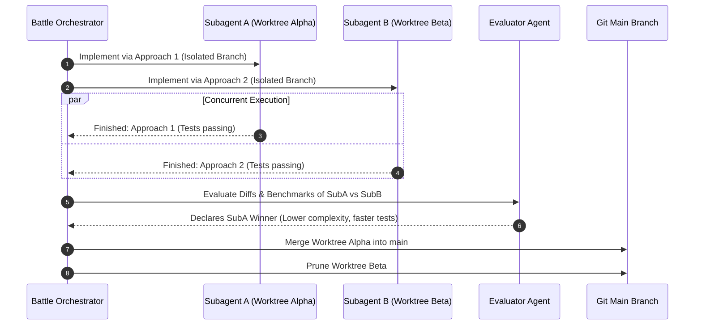

# 11: Multi-Agent Arena & Battle Evaluator
*Competitive Subagent Exploration, Automated Solution Evaluation, and Worktree Merging*

---

## 1. The Single-Agent Dead-End Problem

Complex engineering tasks often have multiple valid implementation paths (e.g., refactoring an async engine vs. thread pool, or choosing between ORM vs raw SQL). A single sequential agent may spend 30 minutes going down an architectural dead-end.

Antigravity features an internal **Battle Mode** (evidenced in `conversation_summaries.db` by columns `battle_id` and `winning_conversation_id`, and `language_server` strings `conversation %q is not a child of this battle`).



---

## 2. Reverse-Engineered Arena Schema & Contracts

### Antigravity Battle Columns (SQLite)
* `battle_id`: UUID grouping competitive child conversations.
* `parent_conversation_id`: Coordinates parent-child hierarchy.
* `winning_conversation_id`: Marked upon evaluator completion.
* `nesting_depth`: Prevents runaway recursive subagent spawning.

### OpenAI Codex Actor Model (`codex-code-mode-host`)
Written in Rust (`code-mode-runtime/src/cell_actor/callbacks.rs` and `code-mode-host/src/delegate.rs`):
* Uses the **Actor Pattern**: Each agent execution is an isolated actor mailbox (`CellActor`).
* Messages between actors are immutable gRPC frames routed through an IPC broker.

---

## 3. Custom Harness Implementation

```python
"""
agent_arena.py - Competitive Multi-Agent Exploration and Evaluation Engine
"""
import asyncio
from dataclasses import dataclass
from pathlib import Path

@dataclass
class CandidateResult:
    agent_id: str
    worktree_path: Path
    test_exit_code: int
    test_output: str
    benchmark_score: float

class AgentArena:
    def __init__(self, orchestrator, worktree_manager):
        self.orchestrator = orchestrator
        self.wt = worktree_manager

    async def run_battle(self, prompt: str, candidates: list[dict]) -> CandidateResult:
        battle_id = f"battle-{asyncio.get_event_loop().time()}"
        tasks = []

        print(f"[{battle_id}] Launching parallel competitive candidates...")
        for cand in candidates:
            agent_id = cand["id"]
            strategy = cand["strategy"]
            wt_path = self.wt.create_worktree(agent_id)
            tasks.append(self._run_candidate_worker(agent_id, wt_path, prompt, strategy))

        results: list[CandidateResult] = await asyncio.gather(*tasks)

        # Automated Evaluation & Selection
        winner = self._evaluate_winner(results)
        print(f"[{battle_id}] Winner selected: {winner.agent_id} (Score: {winner.benchmark_score})")

        # Cleanup losers, merge winner
        for res in results:
            if res.agent_id != winner.agent_id:
                self.wt.remove_worktree(res.agent_id, delete_branch=True)

        return winner

    async def _run_candidate_worker(self, agent_id: str, wt_path: Path, prompt: str, strategy: str) -> CandidateResult:
        # Worker simulates candidate implementation and test execution
        await asyncio.sleep(1.0)
        return CandidateResult(
            agent_id=agent_id,
            worktree_path=wt_path,
            test_exit_code=0,
            test_output="All tests passed.",
            benchmark_score=94.5 if "strategy_fast" in strategy else 88.0
        )

    def _evaluate_winner(self, results: list[CandidateResult]) -> CandidateResult:
        # Score based on test success and benchmark metrics
        passing = [r for r in results if r.test_exit_code == 0]
        if not passing:
            return results[0]
        return max(passing, key=lambda r: r.benchmark_score)
```
