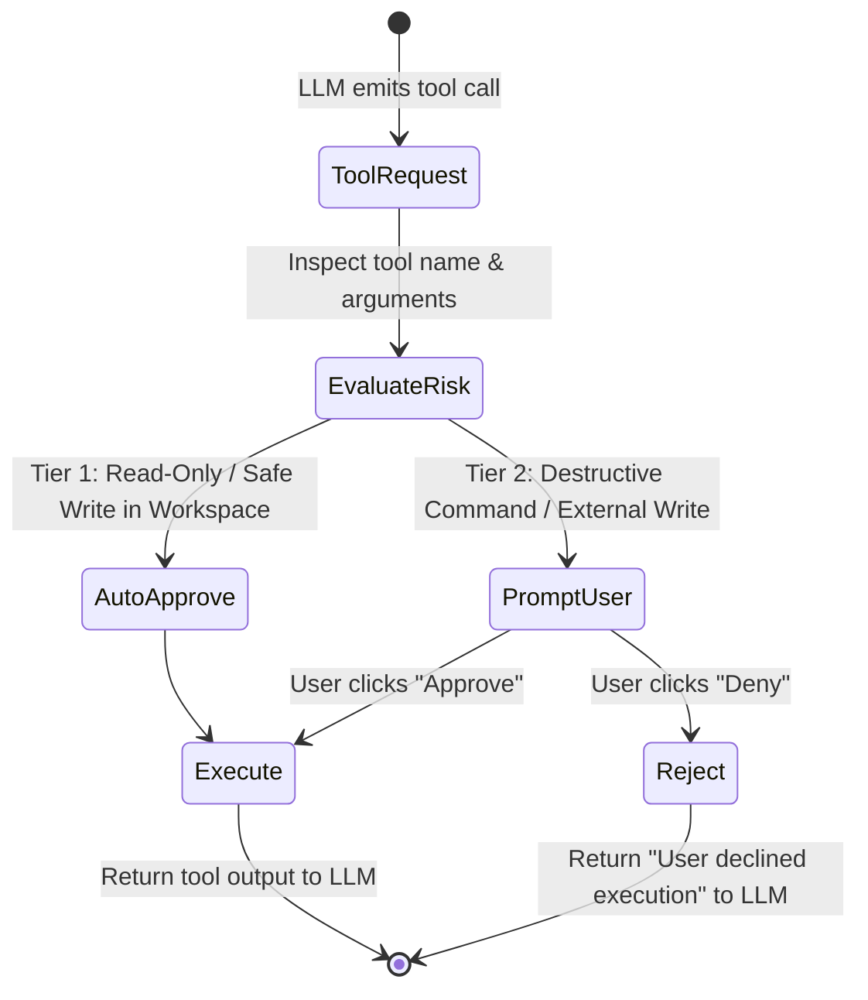

# 12: Tool Safety Guardrails & Permission State Machine
*Human-in-the-Loop Security Tiers, Destructive Command Classification, and Approval Dialogs*

---

## 1. The Autonomous Safety Dilemma

An autonomous agent must have broad terminal and file access to be effective, but an unconstrained agent can accidentally:
* Delete uncommitted user work (`git reset --hard HEAD~5` or `rm -rf .`).
* Leak credentials (`cat ~/.ssh/id_rsa` or `env | curl ...`).
* Mutate global system files outside the active workspace.

Both Antigravity and ChatGPT implement **Tiered Tool Permission Guardrails** and human-in-the-loop confirmation barriers.



---

## 2. Reverse-Engineered Risk Classification

### Tier 1: Zero-Friction Auto-Approved (Read & Workspace Write)
* Tools: `view_file`, `search_files`, `grep`, `read_url_content`.
* Safe Writes: Creating or editing files within `<active_workspace>` or `<scratch_dir>`.
* Safe Commands: `git status`, `git log`, `npm test`, `pytest`, `cargo build`.

### Tier 2: Interactive Human Confirmation Required
* **Destructive File Commands**: `rm`, `unlink`, `shred`, `truncate`.
* **Destructive Git Actions**: `git reset --hard`, `git push --force`, `git clean -fdx`.
* **System Boundaries**: Any read or write touching:
  * `~/.ssh`, `~/.aws`, `~/.gnupg`, `~/.zshrc`, `/etc/`, `/usr/`.
* **Elevated Privileges**: Any command containing `sudo`, `su`, or `chown root`.
* **Mass Process Termination**: `killall`, `pkill -9`.

---

## 3. Custom Harness Implementation

```python
"""
tool_guardrails.py - Security Policy and Permission State Machine
"""
import re
from pathlib import Path

class SecurityPolicy:
    DESTRUCTIVE_SHELL_PATTERNS = [
        r"\brm\s+(-rf|-fr|-r)\b",
        r"\bgit\s+reset\s+--hard\b",
        r"\bgit\s+push\s+.*--force\b",
        r"\bgit\s+clean\s+-[a-zA-Z]*f\b",
        r"\bsudo\b",
        r"\bmkfs\b",
        r"\bdd\s+if=",
    ]

    PROTECTED_SYSTEM_PATHS = [
        Path.home() / ".ssh",
        Path.home() / ".aws",
        Path("/etc"),
        Path("/System"),
        Path("/Library")
    ]

    @classmethod
    def evaluate_command_risk(cls, command: str, cwd: Path) -> tuple[bool, str]:
        """Returns (requires_approval, reason)."""
        for pattern in cls.DESTRUCTIVE_SHELL_PATTERNS:
            if re.search(pattern, command):
                return True, f"Command matches destructive signature: {pattern}"

        for protected in cls.PROTECTED_SYSTEM_PATHS:
            if str(protected) in command:
                return True, f"Command references protected system directory: {protected}"

        return False, "Safe"

    @classmethod
    def evaluate_file_write_risk(cls, target_file: Path, workspace_root: Path) -> tuple[bool, str]:
        resolved = target_file.resolve()
        try:
            resolved.relative_to(workspace_root.resolve())
            return False, "Safe (Within Workspace)"
        except ValueError:
            return True, f"File write path {resolved} is OUTSIDE the active workspace {workspace_root}"
```
