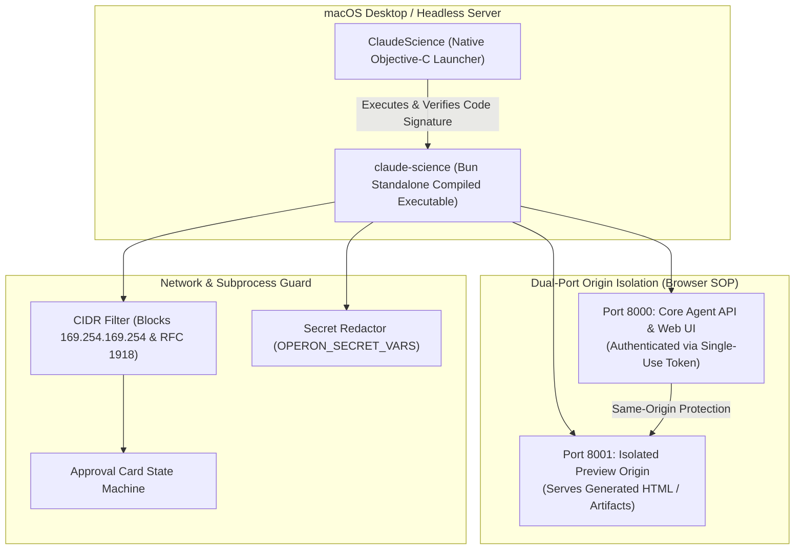

# 13: Claude Cowork (Operon) Architecture
*Reverse-Engineered Bun Daemon, Dual-Port Origin Sandboxing, and Network Approval Cards*

---

## 1. System Overview & The Operon Runtime

Anthropic's agentic Cowork runtime (internally codenamed **Operon**, distributed as [`Claude Science.app`](file:///Applications/Claude.app)) shifts away from heavyweight Electron bundles in favor of a **single compiled binary daemon**:



---

## 2. Reverse-Engineered Architectural Innovations

### A. Bun-Compiled Standalone Daemon (`claude-science`)
Located at [`/Applications/Claude.app/Contents/Resources/bin/claude-science`](file:///Applications/Claude.app/Contents/Resources/bin/claude-science) (122.8 MB):
* **Single Executable**: Built with `bun build --compile`, embedding the JavaScript runtime, HTTP engine (`Bun.serve`), and Zod schemas into a single native Mach-O arm64 binary.
* **Browser-First & Headless Flexibility**:
  * On a laptop: `claude-science serve` opens the default browser directly to a single-use token URL (`claude-science url`).
  * On a remote server/cloud: `claude-science serve --no-browser --detached` runs in the background, allowing frictionless access over SSH tunnels without needing X11/Wayland display forwarding.

### B. Dual-Port Sandbox Isolation (Browser SOP Defense)
One of the most dangerous vulnerabilities in agent generative UI is **prompt-injection via rendered HTML** (e.g. an agent creates an HTML page that reads `localStorage`, session tokens, or calls internal APIs).

Anthropic completely neutralizes this using **Dual-Port Origin Separation**:
* **Port 8000** (`127.0.0.1:8000`): Serves the trusted Cowork UI, API routes, and session tokens.
* **Port 8001** (`127.0.0.1:8001` / `--sandbox-port`): Serves untrusted user/agent HTML previews.
* **The Web Security Guarantee**: Because web browsers enforce the Same-Origin Policy (SOP) across different ports, code running inside an HTML preview on port 8001 is cryptographically blocked by the browser engine from accessing cookies, storage, or APIs on port 8000!

### C. Network CIDR Protection & Cloud Metadata Shield
Discovered in `claude-science` binary string tables:
* Explicit subnet blocks for:
  * `169.254.169.254` (AWS, GCP, Azure Instance Metadata Service).
  * `10.0.0.0/8`, `172.16.0.0/12`, `192.168.0.0/16` (RFC 1918 Private Intranets).
  * `127.0.0.0/8` (Loopback services).
* When Claude attempts to fetch or connect to these addresses, execution pauses and an interactive **Approval Card** is rendered in the UI requiring explicit user confirmation.

### D. Zod-Discriminated Resource Model
Claude Cowork models resources with strict typing:
```typescript
type Resource = 
  | { kind: "artifact"; artifactId: string; versionId: string }
  | { kind: "local"; absPath: string; mtime?: number; checksum?: string } // SHA-256
  | { kind: "remote"; provider: string; path: string };
```

---

## 3. Custom Harness Implementation

```python
"""
dual_port_sandbox.py - Dual-Port Origin Isolation Server
Implements Anthropic's browser SOP defense against malicious generated HTML previews.
"""
import asyncio
from aiohttp import web

class DualPortHarnessServer:
    def __init__(self, main_port: int = 8000, sandbox_port: int = 8001):
        self.main_port = main_port
        self.sandbox_port = sandbox_port
        self.rendered_previews: dict[str, str] = {}

    async def handle_main_api(self, request):
        return web.json_response({"status": "authenticated", "session": "active"})

    async def handle_sandbox_preview(self, request):
        preview_id = request.match_info.get("id")
        html = self.rendered_previews.get(preview_id, "<h1>Preview Not Found</h1>")
        # Strict security headers on preview origin
        headers = {
            "Content-Security-Policy": "default-src 'self' 'unsafe-inline' data:; connect-src 'none';",
            "X-Frame-Options": "SAMEORIGIN"
        }
        return web.Response(text=html, content_type="text/html", headers=headers)

    async def start(self):
        # 1. Main API App
        app_main = web.Application()
        app_main.router.add_get("/api/status", self.handle_main_api)
        runner_main = web.AppRunner(app_main)
        await runner_main.setup()
        site_main = web.TCPSite(runner_main, "127.0.0.1", self.main_port)
        await site_main.start()

        # 2. Isolated Preview App (Different Port / Origin)
        app_sandbox = web.Application()
        app_sandbox.router.add_get("/preview/{id}", self.handle_sandbox_preview)
        runner_sandbox = web.AppRunner(app_sandbox)
        await runner_sandbox.setup()
        site_sandbox = web.TCPSite(runner_sandbox, "127.0.0.1", self.sandbox_port)
        await site_sandbox.start()

        print(f"Main Harness UI running on http://127.0.0.1:{self.main_port}")
        print(f"Isolated Sandbox Preview running on http://127.0.0.1:{self.sandbox_port}")
```
