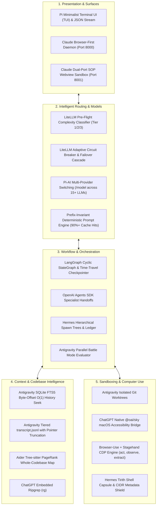

# 14: The Omni-Harness Supreme Architecture
*The Unified Master Synthesis Combining Antigravity, ChatGPT, Claude Cowork, Hermes, Pi, Aider, LangGraph, Browser-Use, Stagehand, and LiteLLM*

---

## 1. The Omni-Harness Convergence

By synthesizing the breakthrough patterns from all eleven major agent systems, we arrive at the blueprint for the **complete, all-encompassing autonomous agent harness**:

---

## 2. Omni-Harness Master Superpower Matrix

| Subsystem Domain | Best Contributing Engine | Key Mechanism Integrated |
| :--- | :--- | :--- |
| **Daemon & Host Topology** | **Claude Cowork (Operon)** | Standalone Bun/Python binary; browser-first via single-use token links; runs locally or over SSH. |
| **Prompt Architecture** | **Pi + Prompt Caching Core**| Ultra-compact (<1k token) prompt with strict 5-tier deterministic prefix invariance (90%+ cache hits). |
| **Multi-Provider Normalization**| **Pi (`pi-ai`)** | Unified streaming and tool calling across 15+ providers with mid-session model switching (`/model`). |
| **Intelligent Model Routing** | **LiteLLM + OpenRouter** | Pre-flight intent tiering (Fast / Balanced / Reasoning) + adaptive circuit breaker on HTTP 429/503. |
| **Codebase Structural Mapping** | **Aider (`repomap`)** | Tree-sitter AST extraction + PageRank symbol centrality, packing 100k lines into 1k tokens. |
| **Multi-File Code Modification** | **Aider (Architect/Editor)**| Frontier reasoning model plans architecture; fast model applies search/replace diff blocks. |
| **Workflow State Machine** | **LangGraph** | Cyclic state graphs with persistent checkpointing (SQLite) enabling time-travel debugging. |
| **Specialist Delegation** | **OpenAI Agents SDK** | Direct agent handoffs (`transfer_to_agent`) and agents-as-tools without master bottle-necking. |
| **Worker Workspace Sandboxing** | **Antigravity** | Dynamic Git worktrees (`git worktree add`) ensuring zero-collision parallel file editing. |
| **Multi-Agent Task Tracking** | **Hermes** | Hierarchical spawn trees (`spawn-ledger.json`) with persistent state machines in SQLite. |
| **Parallel Solution Search** | **Antigravity** | Battle Mode: launches parallel candidate branches, tests concurrently, and merges the winner. |
| **Desktop Automation** | **ChatGPT (`@oai/sky`)** | Native macOS Accessibility (`AXUIElement`) and ScreenCaptureKit for non-brittle GUI interaction. |
| **Browser Web Automation** | **Browser-Use + Stagehand** | Type-safe CDP connection, pruned accessibility trees, and semantic `act`/`observe`/`extract` primitives. |
| **Long-Term Memory** | **Antigravity** | SQLite FTS5 database storing byte offsets into raw JSONL transcripts for instant O(1) recall. |
| **Webview Security** | **Claude Cowork** | Dual-port origin separation (Port 8000 for API vs Port 8001 for previews) enforcing browser SOP. |
| **Shell & Network Guardrails** | **Hermes (`tirith`) + Claude**| Blast-radius command preview, credential leak gating, and CIDR subnet shields (`169.254.169.254`). |
| **Self-Healing Loop** | **Aider** | Auto-commits git transactions; catches compiler/test failures and feeds them back until green. |

---

## 3. Complete 21-Document Specification Suite

All 21 specification and implementation guides are located at:
📁 [`./`](./)

* [`00_README_AND_MANIFEST.md`](./00_README_AND_MANIFEST.md) - Master repository manifest.
* [`01_SYSTEM_TOPOLOGY_AND_ENGINE_DESIGN.md`](./01_SYSTEM_TOPOLOGY_AND_ENGINE_DESIGN.md) - Multi-process host and daemon decoupling.
* [`02_IPC_PROTOCOLS_AND_EVENT_STREAMING.md`](./02_IPC_PROTOCOLS_AND_EVENT_STREAMING.md) - JSON-RPC 2.0 streaming and reactive zero-polling wakeup loops.
* [`03_CONTEXT_ENGINE_AND_TRANSCRIPT_STORAGE.md`](./03_CONTEXT_ENGINE_AND_TRANSCRIPT_STORAGE.md) - Tiered JSONL transcripts and trajectory compaction.
* [`04_PROGRESSIVE_SKILLS_AND_PLUGIN_SYSTEM.md`](./04_PROGRESSIVE_SKILLS_AND_PLUGIN_SYSTEM.md) - Progressive `SKILL.md` playbooks and `.codex-plugin/plugin.json`.
* [`05_EXECUTION_SANDBOX_AND_GIT_WORKTREES.md`](./05_EXECUTION_SANDBOX_AND_GIT_WORKTREES.md) - Subagent Git worktree dynamic sandboxing.
* [`06_COMPUTER_USE_AND_DESKTOP_INTEGRATION.md`](./06_COMPUTER_USE_AND_DESKTOP_INTEGRATION.md) - Native macOS Accessibility & ScreenCaptureKit `@oai/sky` bridge.
* [`07_GENERATIVE_UI_AND_ARTIFACT_SYSTEM.md`](./07_GENERATIVE_UI_AND_ARTIFACT_SYSTEM.md) - Artifact protocol and sandboxed webview bridge.
* [`08_BUILD_BLUEPRINT_AND_STARTER_IMPLEMENTATION.md`](./08_BUILD_BLUEPRINT_AND_STARTER_IMPLEMENTATION.md) - Phased roadmap and complete runnable Python proof-of-concept.
* [`09_SEARCH_INDEXING_AND_SQLITE_FTS5_ENGINE.md`](./09_SEARCH_INDEXING_AND_SQLITE_FTS5_ENGINE.md) - SQLite FTS5 byte-offset O(1) memory seeking.
* [`10_PROMPT_CACHING_AND_PREFIX_INVARIANCE.md`](./10_PROMPT_CACHING_AND_PREFIX_INVARIANCE.md) - Deterministic 5-tier prompt layouts for 90%+ cache hits.
* [`11_MULTI_AGENT_ARENA_AND_BATTLE_EVALUATOR.md`](./11_MULTI_AGENT_ARENA_AND_BATTLE_EVALUATOR.md) - Battle Mode parallel solution exploration.
* [`12_TOOL_SAFETY_GUARDRAILS_AND_PERMISSIONS.md`](./12_TOOL_SAFETY_GUARDRAILS_AND_PERMISSIONS.md) - Destructive command regex gating and approval state machines.
* [`13_CLAUDE_COWORK_OPERON_ARCHITECTURE.md`](./13_CLAUDE_COWORK_OPERON_ARCHITECTURE.md) - Claude Cowork (Operon) Bun daemon and dual-port SOP sandbox.
* [`14_THE_ULTIMATE_HYBRID_HARNESS_SYNTHESIS.md`](./14_THE_ULTIMATE_HYBRID_HARNESS_SYNTHESIS.md) - The Omni-Harness Supreme Master Blueprint.
* [`15_HERMES_MULTI_AGENT_AND_TIRITH_SECURITY.md`](./15_HERMES_MULTI_AGENT_AND_TIRITH_SECURITY.md) - Hermes spawn trees, SQLite state machine, and Tirith security.
* [`16_PI_MINIMALIST_AGENT_AND_CHORD_RUNTIME.md`](./16_PI_MINIMALIST_AGENT_AND_CHORD_RUNTIME.md) - Pi minimalist agent loop, chord runtime, and model switching.
* [`17_AIDER_REPOMAP_AND_ARCHITECT_EDITOR_LOOP.md`](./17_AIDER_REPOMAP_AND_ARCHITECT_EDITOR_LOOP.md) - Aider Tree-sitter repo map, architect/editor pattern, and diff parser.
* [`18_BROWSER_COMPUTER_USE_AND_CDP_STAGEHAND_ENGINE.md`](./18_BROWSER_COMPUTER_USE_AND_CDP_STAGEHAND_ENGINE.md) - Browser automation via CDP, accessibility tree pruning, and Stagehand primitives.
* [`19_STATE_GRAPH_ORCHESTRATION_AND_AGENT_HANDOFFS.md`](./19_STATE_GRAPH_ORCHESTRATION_AND_AGENT_HANDOFFS.md) - LangGraph state graphs, checkpointing, and OpenAI agent handoffs.
* [`20_INTELLIGENT_MODEL_ROUTING_AND_FAILOVER_CIRCUITS.md`](./20_INTELLIGENT_MODEL_ROUTING_AND_FAILOVER_CIRCUITS.md) - LiteLLM / OpenRouter pre-flight intent classification and adaptive failover circuits.
