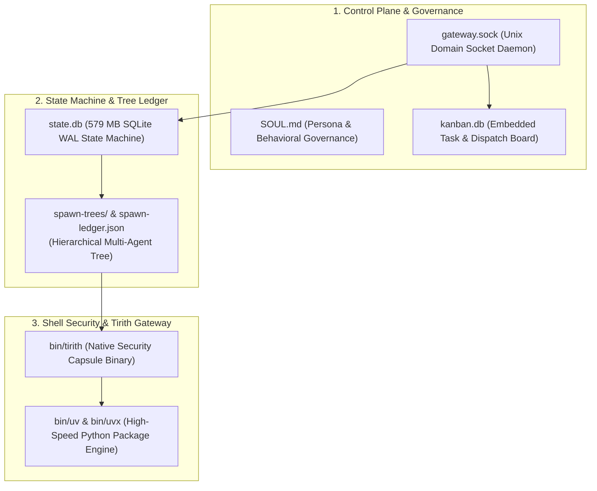

# 15: Hermes Multi-Agent & Tirith Security Engine
*Hierarchical Spawn Trees, SQLite State Machines, and Shell Containment Gateways*

---

## 1. Hermes Architectural Overview

Inspecting your active installation at `~/.hermes` reveals an industrial-grade, long-running agent daemon designed for complex multi-agent workflows and fail-safe security:



---

## 2. Reverse-Engineered Hermes Superpowers

### A. Hierarchical Multi-Agent Spawn Trees (`spawn-ledger.json`)
Hermes handles task decomposition using a formal parent-child spawn hierarchy:
* Each child agent receives a bounded capability envelope, an isolated execution workspace, and a parent tracking link.
* States transition through `PENDING` -> `RUNNING` -> `COMMITTED` -> `RECONCILED`.
* The parent monitors the tree via `gateway_state.json` without blocking the root interactive session.

### B. Persistent SQLite State Engine (`state.db`)
* Operating with Write-Ahead Logging (WAL) and memory-mapped I/O (`PRAGMA mmap_size`), Hermes ensures that crashes or process terminations never corrupt session histories, tool state, or active variables.
* Multi-table relational model tracks:
  * `sessions`: Conversation threads and parent lineages.
  * `memories`: Cross-session distilled lessons learned and user preferences.
  * `verification_evidence`: Cryptographic hashes of tool outputs and test runs.

### C. Tirith Security & Containment Gateway (`bin/tirith`)
Located at `~/.hermes/bin/tirith` (32.5 MB Mach-O arm64 binary):
* **URL & Shell Security Firewall**: Intercepts shell tool invocations before execution.
* **Blast Radius Preview**: Analyzes shell scripts and predicts file changes before running.
* **Secret Leak Gating**: Scans terminal outputs, logs, and clipboard for credential patterns (`AWS_SECRET_ACCESS_KEY`, `id_rsa`, tokens) and redacts them in real time.
* **Fail-Closed Containment Capsules**: On Linux/macOS, sandboxes untrusted script runs inside temporary isolated capsules.

---

## 3. Custom Harness Implementation

```python
"""
hermes_spawn_tree.py - Hierarchical Agent Spawn Tree Manager
"""
from dataclasses import dataclass, field
import json
from pathlib import Path
import time
import uuid

@dataclass
class AgentNode:
    agent_id: str
    parent_id: str | None
    role: str
    status: str = "PENDING"
    created_at: float = field(default_factory=time.time)
    children: list[str] = field(default_factory=list)

class SpawnTreeManager:
    def __init__(self, ledger_file: Path):
        self.ledger_file = ledger_file
        self.nodes: dict[str, AgentNode] = {}
        self._load()

    def spawn_child(self, parent_id: str, role: str) -> str:
        child_id = f"agent-{uuid.uuid4().hex[:8]}"
        node = AgentNode(agent_id=child_id, parent_id=parent_id, role=role, status="RUNNING")
        self.nodes[child_id] = node
        if parent_id in self.nodes:
            self.nodes[parent_id].children.append(child_id)
        self._persist()
        return child_id

    def reconcile_child(self, child_id: str, status: str = "COMMITTED"):
        if child_id in self.nodes:
            self.nodes[child_id].status = status
            self._persist()

    def _persist(self):
        data = {k: v.__dict__ for k, v in self.nodes.items()}
        self.ledger_file.write_text(json.dumps(data, indent=2), encoding="utf-8")

    def _load(self):
        if self.ledger_file.exists():
            data = json.loads(self.ledger_file.read_text(encoding="utf-8"))
            for k, v in data.items():
                self.nodes[k] = AgentNode(**v)
```
