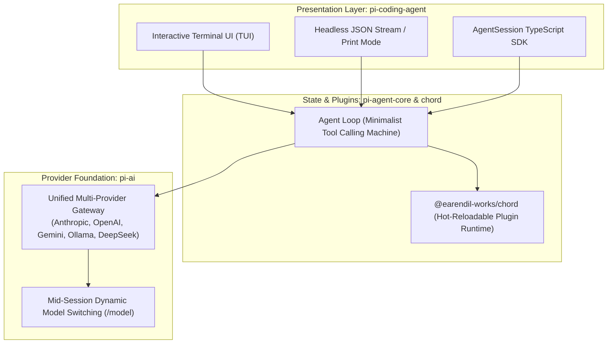

# 16: Pi Minimalist Agent & Chord Runtime
*Ultra-Compact Prompts (<1,000 Tokens), Universal Multi-Provider API, and Dynamic Model Switching*

---

## 1. Pi Architectural Overview

Created by Mario Zechner ([`earendil-works/pi`](https://github.com/earendil-works/pi)), **Pi** is the gold standard for minimalist, zero-bloat coding agent harnesses. While other harnesses suffer from prompt bloat and provider lock-in, Pi enforces strict modular decoupling:



---

## 2. Reverse-Engineered Pi Superpowers

### A. The Ultra-Compact System Prompt (< 1,000 Tokens)
Most commercial harnesses waste 4,000 to 10,000 tokens on redundant behavioral rules, formatting lectures, and guardrails.
* Pi proves that frontier models (Sonnet, GPT-4o, DeepSeek) perform best with **minimalist scaffolding**:
  * 4 core primitives: `read`, `write`, `edit`, `bash`.
  * Concise rules for path resolution and error reporting.
* **Benefit**: Leaves 99% of the active context window free for actual source code and compiler logs.

### B. Universal Multi-Provider Normalization (`pi-ai`)
* Normalizes streaming text, thinking/reasoning blocks, tool calls, and usage metrics across 15+ providers into a single uniform event stream:
  ```typescript
  type StreamChunk = 
    | { type: "text-delta"; text: string }
    | { type: "thinking-delta"; thinking: string }
    | { type: "tool-call-start"; id: string; name: string }
    | { type: "tool-call-delta"; arguments: string }
    | { type: "done"; usage: TokenUsage };
  ```

### C. Mid-Session Dynamic Model Switching (`/model`)
* Because `pi-ai` normalizes provider schemas, users can switch models mid-flight (e.g. use a fast reasoning model to plan, then switch to a cheap local Ollama model to write boilerplate, then back to Claude to review) without dropping conversation history or clearing variables.

---

## 3. Custom Harness Implementation

```python
"""
minimal_agent_loop.py - Pi-Inspired Minimalist Agent Machine
Clean-room Python implementation of Pi's <1,000-token prompt and unified loop.
"""
from dataclasses import dataclass
from typing import Any, Callable

MINIMAL_SYSTEM_PROMPT = """You are a capable, pragmatic AI coding assistant.
You have tools to read, edit, and write files, and run terminal commands.
Be concise. Execute changes directly rather than describing what you will do.
When editing code, prefer minimal targeted edits over rewriting entire files."""

@dataclass
class ToolDefinition:
    name: str
    description: str
    parameters: dict[str, Any]
    handler: Callable

class MinimalAgentLoop:
    def __init__(self, provider_client, model_name: str = "gpt-4o"):
        self.client = provider_client
        self.model_name = model_name
        self.system_prompt = MINIMAL_SYSTEM_PROMPT
        self.tools: dict[str, ToolDefinition] = {}
        self.messages: list[dict] = []

    def switch_model(self, new_model: str):
        """Dynamic mid-session model switching (Pi /model pattern)."""
        print(f"[Model Switch] Transitioning active provider to {new_model} without clearing context.")
        self.model_name = new_model

    def register_tool(self, tool: ToolDefinition):
        self.tools[tool.name] = tool

    async def step(self, user_input: str) -> str:
        self.messages.append({"role": "user", "content": user_input})
        
        while True:
            # Query active model
            response = await self.client.chat_complete(
                model=self.model_name,
                system=self.system_prompt,
                messages=self.messages,
                tools=[t.parameters for t in self.tools.values()]
            )

            if response.tool_calls:
                # Execute tools and loop
                for call in response.tool_calls:
                    handler = self.tools[call.name].handler
                    result = await handler(**call.arguments)
                    self.messages.append({
                        "role": "tool",
                        "tool_call_id": call.id,
                        "content": str(result)
                    })
            else:
                self.messages.append({"role": "assistant", "content": response.text})
                return response.text
```
