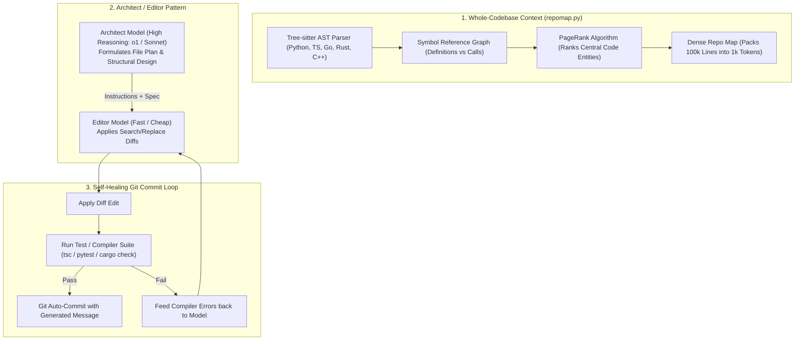

# 17: Aider Repo Map & Architect-Editor Loop
*Tree-sitter PageRank Codebase Maps, Dual-Model Architect/Editor, and Self-Healing Git Loops*

---

## 1. Aider Architectural Overview

Created by Paul Gauthier ([`Aider-AI/aider`](https://github.com/Aider-AI/aider)), **Aider** is the industry standard for terminal pair-programming precision, pioneering three critical concepts:



---

## 2. Reverse-Engineered Aider Superpowers

### A. The Tree-sitter PageRank Repo Map
Dumping entire source files into an LLM context quickly burns through tokens and distracts attention.
* Aider uses **Tree-sitter** to extract tag definitions (classes, functions, methods) and tag references (function calls, imports) across all repository files.
* Builds a directed symbol graph where edges represent cross-file dependencies.
* Runs **PageRank** to identify the most structurally important definitions.
* Packs the top symbols into a dense markdown outline fitting within a strict budget (e.g. 1,024 tokens):
  ```text
  src/auth/service.py:
    class AuthService:
      def authenticate(user: str, token: str) -> bool:
      def revoke_session(session_id: str):
  src/db/models.py:
    class User(BaseModel):
      id: UUID
      email: str
  ```

### B. The Architect / Editor Dual-Model Pattern
* Solves the trade-off between reasoning capability and cost:
  * **Architect**: A frontier reasoning model (Claude 3.7 Sonnet / o1 / o3-mini) plans the multi-file architecture.
  * **Editor**: A fast, inexpensive model translates the architect's plan into exact diffs.
* Reduces execution cost by 60–80% without sacrificing architectural soundness.

### C. Self-Healing Git Transaction Loop
* Every edit is wrapped in a git transaction:
  1. Check out clean working tree.
  2. Apply search/replace diff.
  3. Run configured linter / test command (`pytest`, `npm test`, `cargo check`).
  4. If tests pass -> auto-commit with concise commit message.
  5. If tests fail -> capture stderr, prompt the editor model with the error, and iterate until green (up to 3 tries).

### D. Search/Replace Block Diff Formatting
Prevents models from hallucinating or omitting code with `// rest of file unchanged`:
```text
<<<<<<< SEARCH
def validate_token(token: str) -> bool:
    return token == "secret"
=======
def validate_token(token: str) -> bool:
    return hmac.compare_digest(token, SECRET_KEY)
>>>>>>> REPLACE
```

---

## 3. Custom Harness Implementation

```python
"""
search_replace_differ.py - Aider-Style Search/Replace Diff Parser and Applier
"""
import re
from pathlib import Path

class DiffApplier:
    PATTERN = re.compile(r"<<<<<<< SEARCH\n(.*?)\n=======\n(.*?)\n>>>>>>> REPLACE", re.DOTALL)

    @classmethod
    def apply_diff(cls, file_path: Path, diff_block: str) -> bool:
        if not file_path.exists():
            return False

        content = file_path.read_text(encoding="utf-8")
        matches = list(cls.PATTERN.finditer(diff_block))
        if not matches:
            return False

        new_content = content
        for match in matches:
            search_text = match.group(1)
            replace_text = match.group(2)

            if search_text not in new_content:
                raise ValueError(f"Search block not found in {file_path}:\n{search_text}")

            new_content = new_content.replace(search_text, replace_text, 1)

        file_path.write_text(new_content, encoding="utf-8")
        return True
```
