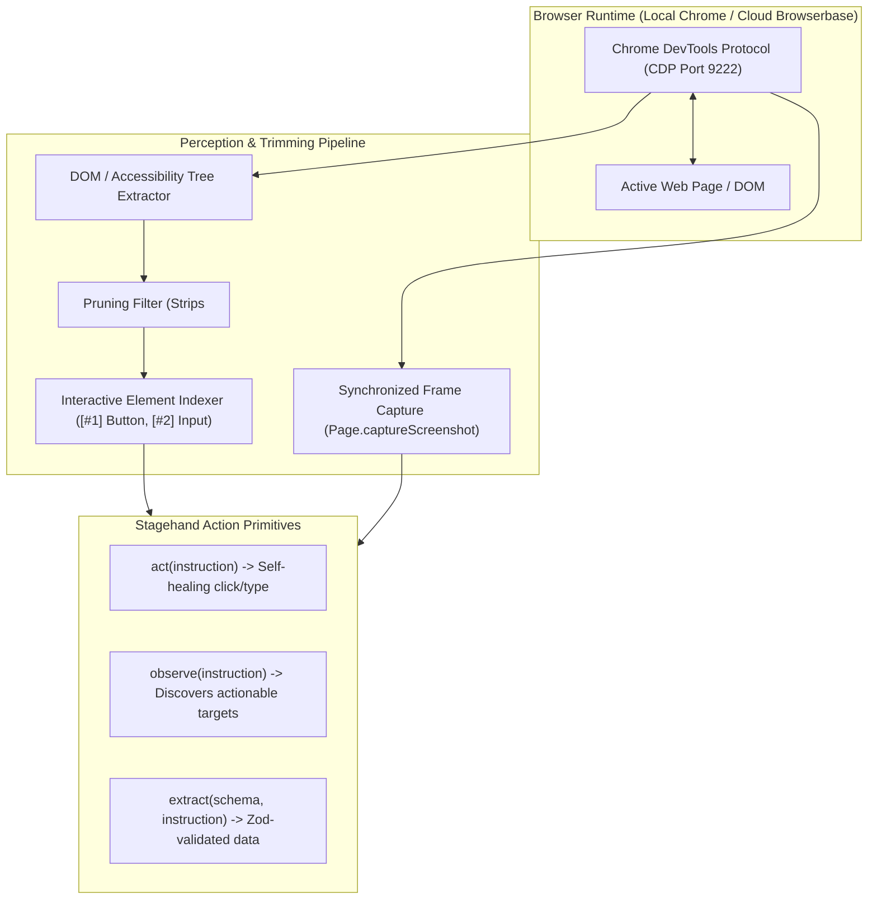

# 18: Browser Computer Use & CDP Stagehand Engine
*Chrome DevTools Protocol (CDP), Accessibility Tree Pruning, and Stagehand AI Primitives*

---

## 1. Desktop vs. Browser Computer Use

While Desktop Computer Use ([`06_COMPUTER_USE_AND_DESKTOP_INTEGRATION.md`](file:///Users/brightech/.gemini/antigravity/scratch/custom-harness-specs/06_COMPUTER_USE_AND_DESKTOP_INTEGRATION.md)) controls native macOS windows via accessibility APIs and mouse events, **Browser Computer Use** requires direct integration with the web browser runtime:



---

## 2. Reverse-Engineered Browser Superpowers

### A. The Pruned Accessibility Tree (`cdp-use` Pattern)
Feeding raw HTML (often 500k+ tokens) into an LLM causes prompt overflows and hallucinations.
* Uses CDP commands (`DOM.getDocument`, `Accessibility.getFullAXTree`, `Runtime.evaluate`).
* Strips non-interactive elements, scripts, styles, and hidden CSS nodes.
* Assigns deterministic numerical indices to interactive targets:
  ```text
  [#12] Input: "Search documentation..." (x: 240, y: 32, w: 200, h: 36)
  [#13] Button: "Submit Query" (x: 450, y: 32, w: 80, h: 36)
  [#14] Link: "API Reference" (href: "/api")
  ```
* LLMs output concise, unambiguous actions: `click(13)` or `type(12, "OAuth2")`.

### B. The Stagehand Trio: `act`, `observe`, `extract`
1. **`act(instruction)`**:
   * Uses semantic intent rather than fragile CSS selectors (`#btn-submit-v2`).
   * If a button's class name changes, the semantic engine automatically adapts and finds the new element.
2. **`observe(instruction)`**:
   * Returns a list of actionable candidates without triggering multi-step LLM calls for every click.
3. **`extract(schema, instruction)`**:
   * Scrapes structured, typed JSON data validated against a schema (Zod in TypeScript, Pydantic in Python).

---

## 3. Custom Harness Implementation (Python / CDP Async)

```python
"""
browser_cdp_engine.py - High-Performance Browser Automation Harness
Implements CDP connection, accessibility tree pruning, and Stagehand primitives.
"""
import asyncio
import json
from dataclasses import dataclass
from typing import Any
import websockets

@dataclass
class InteractiveElement:
    index: int
    tag: str
    role: str
    text: str
    bounds: dict[str, float]

class BrowserCDPEngine:
    def __init__(self, cdp_ws_url: str = "ws://127.0.0.1:9222/devtools/page/active"):
        self.ws_url = cdp_ws_url
        self.ws = None
        self._msg_id = 0

    async def connect(self):
        self.ws = await websockets.connect(self.ws_url)
        await self._send("Page.enable")
        await self._send("DOM.enable")
        await self._send("Accessibility.enable")

    async def _send(self, method: str, params: dict = None) -> dict:
        self._msg_id += 1
        req = {"id": self._msg_id, "method": method, "params": params or {}}
        await self.ws.send(json.dumps(req))
        while True:
            resp = json.loads(await self.ws.recv())
            if resp.get("id") == self._msg_id:
                return resp.get("result", {})

    async def capture_state(self) -> dict:
        """Parallel capture of screenshot and pruned interactive elements."""
        # 1. Capture screenshot via CDP
        shot_res = await self._send("Page.captureScreenshot", {"format": "png"})
        screenshot_b64 = shot_res.get("data", "")

        # 2. Extract DOM tree via Runtime evaluation script
        eval_script = """
        (() => {
            const elements = [];
            const walk = (node) => {
                if (node.nodeType === 1) { // ELEMENT_NODE
                    const rect = node.getBoundingClientRect();
                    const isVisible = rect.width > 0 && rect.height > 0;
                    const isInteractive = ['BUTTON', 'A', 'INPUT', 'SELECT', 'TEXTAREA'].includes(node.tagName) 
                        || node.getAttribute('role') === 'button'
                        || node.onclick != null;
                    if (isVisible && isInteractive) {
                        elements.push({
                            tag: node.tagName,
                            text: (node.innerText || node.value || node.placeholder || '').trim().slice(0, 50),
                            bounds: { x: rect.x, y: rect.y, w: rect.width, h: rect.height }
                        });
                    }
                    for (const child of node.children) walk(child);
                }
            };
            walk(document.body);
            return elements;
        })()
        """
        eval_res = await self._send("Runtime.evaluate", {"expression": eval_script, "returnByValue": True})
        raw_elements = eval_res.get("result", {}).get("value", [])

        indexed_elements = [
            InteractiveElement(index=i+1, tag=el["tag"], role=el["tag"].lower(), text=el["text"], bounds=el["bounds"])
            for i, el in enumerate(raw_elements)
        ]

        return {
            "screenshot_b64": screenshot_b64,
            "elements": indexed_elements
        }

    async def click_element(self, element: InteractiveElement):
        """Dispatches synthetic CDP mouse events to element center."""
        cx = element.bounds["x"] + element.bounds["w"] / 2
        cy = element.bounds["y"] + element.bounds["h"] / 2

        await self._send("Input.dispatchMouseEvent", {"type": "mousePressed", "x": cx, "y": cy, "button": "left", "clickCount": 1})
        await self._send("Input.dispatchMouseEvent", {"type": "mouseReleased", "x": cx, "y": cy, "button": "left", "clickCount": 1})
```
