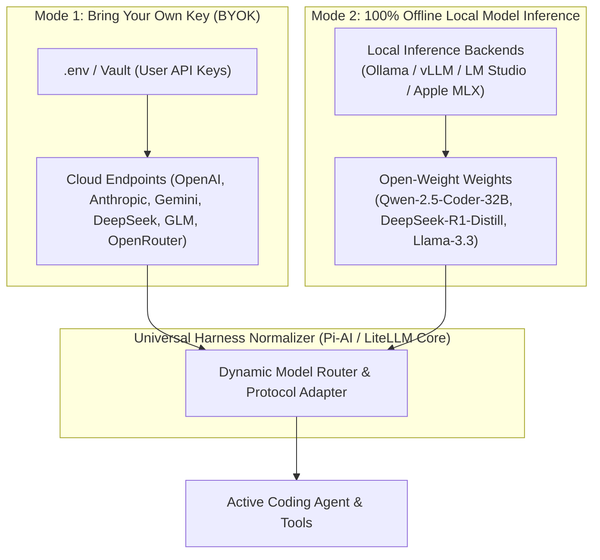
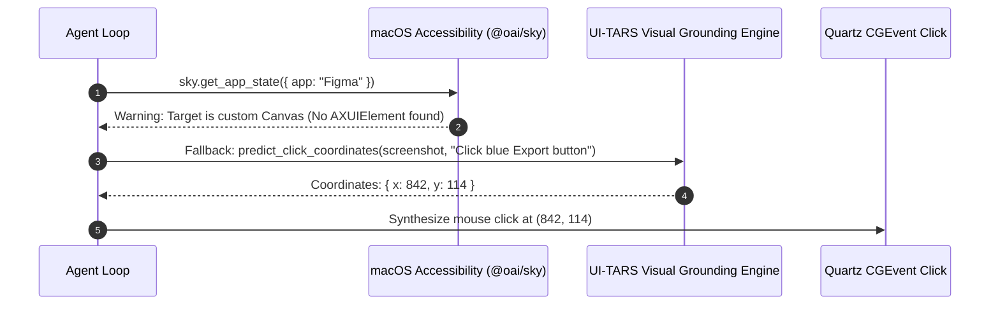

# 21: BYOK, Local Model Engine & Open-Source Harness Synthesis
*Bring Your Own Key, Ollama/vLLM Local Inference, UI-TARS Visual Grounding, and ZCode/Qwen Integration*

---

## 1. Bring Your Own Key (BYOK) & Local-First Philosophy

A truly sovereign agent harness must never be locked behind a single proprietary vendor or paid platform subscription. Your harness natively supports two complementary operational modes:



---

## 2. Assessment of the Open-Source Candidates

| Candidate | Core Superpower | Critical Limitation | Role in Your Custom Harness |
| :--- | :--- | :--- | :--- |
| **ByteDance UI-TARS** (`bytedance/ui-tars-desktop`) | **Visual GUI Grounding**: Predicts precise $(x,y)$ coordinates from raw pixels for any app. | Heavy visual latency compared to direct accessibility trees. | **Visual Grounding Fallback**: When macOS Accessibility (`AXUIElement`) fails (e.g., in WebGL, Canvas, games, or Electron apps), fallback to UI-TARS visual clicking. |
| **ZCode** (`zai-org/zcode`) | Apache-2.0 workspace with MCP, subagents, and browser control; optimized for GLM models. | Model router is static; browser control is desktop-only. | **Reference for GLM / Zhipu Integration**: Excellent reference for wiring Chinese open models (GLM-5.3) into an agent loop. |
| **DeepSeek Harness** (`deepseek-ai/deepseek-harness`) | Plugin-first architecture tailored for DeepSeek-V3 & R1 reasoning. | Early developer preview; no security audit or process containment. | **Reasoning Token Parser**: Reference for parsing DeepSeek-R1 `<think>...</think>` tags cleanly into separate UI thought streams. |
| **Alibaba Qwen-Agent** (`qwenlm/qwen-agent`) | Robust function-calling formatting for open-weight local models. | Heavy Python library; not a standalone desktop harness. | **Local Model Function-Calling Template**: Provides ChatML/XML prompt templates that prevent local models from failing tool JSON generation. |
| **Moonshot Kimi Code** (`moonshotai/kimi-code`) | Clean MCP-enabled CLI with parallel subagents. | Chinese cloud service centric. | Secondary reference for MCP subagent dispatching. |

---

## 3. How to Wire UI-TARS as a Visual Fallback for Computer Use

When macOS Accessibility ([`06_COMPUTER_USE_AND_DESKTOP_INTEGRATION.md`](file:///Users/brightech/.gemini/antigravity/scratch/custom-harness-specs/06_COMPUTER_USE_AND_DESKTOP_INTEGRATION.md)) encounters a custom Canvas or WebGL element where `element_index` cannot be found:



---

## 4. Local Model Function-Calling Adapter (Qwen-Agent Pattern)

Open-weight local models (like `qwen2.5-coder:32b` or `deepseek-r1:14b` running on Ollama) occasionally stumble on complex OpenAI tool JSON formats. This adapter formats tools into native ChatML/XML syntax:

```python
"""
local_model_adapter.py - Local-First & BYOK Provider Adapter
Supports Ollama, vLLM, LM Studio, and Apple MLX with robust XML tool parsing.
"""
import httpx
import json
import re

class LocalModelProvider:
    def __init__(self, base_url: str = "http://localhost:11434/v1", api_key: str = "ollama"):
        self.base_url = base_url.rstrip("/")
        self.api_key = api_key
        self.client = httpx.AsyncClient(base_url=self.base_url, timeout=120.0)

    async def chat_complete_local(self, model: str, system_prompt: str, messages: list[dict], tools: list[dict]) -> dict:
        """Employs Qwen-Agent XML tool calling format for local models."""
        # Inject tool schemas cleanly into system prompt
        tool_desc = json.dumps([t.get("function", t) for t in tools], indent=2)
        formatted_system = (
            f"{system_prompt}\n\n"
            f"# Tool Instructions:\n"
            f"You can call tools using XML tags:\n"
            f"<tool_call>\n{{\"name\": \"tool_name\", \"arguments\": {{...}}}}\n</tool_call>\n\n"
            f"Available tools:\n{tool_desc}"
        )

        payload = {
            "model": model,
            "messages": [{"role": "system", "content": formatted_system}] + messages,
            "temperature": 0.2
        }

        resp = await self.client.post("/chat/completions", json=payload, headers={"Authorization": f"Bearer {self.api_key}"})
        resp.raise_for_status()
        data = resp.json()
        raw_text = data["choices"][0]["message"]["content"]

        # Parse XML tool calls if present
        tool_match = re.search(r"<tool_call>\s*(.*?)\s*</tool_call>", raw_text, re.DOTALL)
        if tool_match:
            try:
                call_data = json.loads(tool_match.group(1))
                return {
                    "text": raw_text[:tool_match.start()].strip(),
                    "tool_calls": [{"name": call_data["name"], "arguments": call_data["arguments"]}]
                }
            except Exception:
                pass

        return {"text": raw_text, "tool_calls": []}
```
