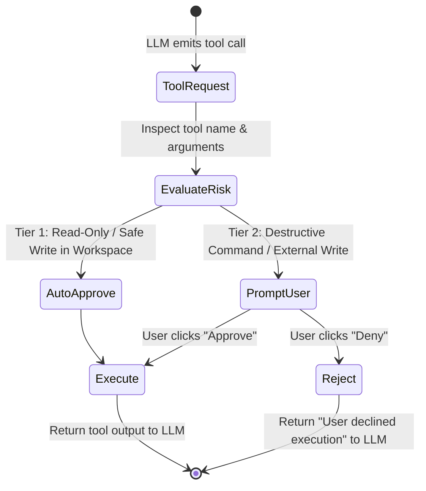

# 12: Tool Safety Guardrails & Permission State Machine
*Human-in-the-Loop Security Tiers, Destructive Command Classification, and Approval Dialogs*

---

## 1. The Autonomous Safety Dilemma

An autonomous agent must have broad terminal and file access to be effective, but an unconstrained agent can accidentally:
* Delete uncommitted user work (`git reset --hard HEAD~5` or `rm -rf .`).
* Leak credentials (`cat ~/.ssh/id_rsa` or `env | curl ...`).
* Mutate global system files outside the active workspace.

Both Antigravity and ChatGPT implement **Tiered Tool Permission Guardrails** and human-in-the-loop confirmation barriers.



---

## 1a. Current implementation status (WS-06, 2026-10-16)

The older sections below are research/design notes, not an assertion that every listed guardrail was already
implemented. WS-06 now adds a named permission preset resolver (`locked`, `careful`, `standard`, `open`) in
`harness/kernel/presets.py`; explicit settings remain pinned, derived values are not written to disk, and
`security.status` reports the resolved values and customisations. The `bypass` mode is not a preset.

OS confinement is enforced at the executor seam (`harness/kernel/sandbox.py`), after policy/approval and before
any `Process` starts. Linux bubblewrap is namespace-probed; macOS Seatbelt is implemented and labelled `partial`.
Required-but-unavailable denies; preferred-but-unavailable asks before any unconfined fallback; the process result
reports the backend and enforcement fact in `ExecResult.metadata.sandbox`. The schema-driven Studio exposes the
preset and backend state, and its badge is sourced from the same status command as the CLI and `/health`.

It is not a VM: only child processes routed through `ctx.executor` are confined. Provider HTTP clients, MCP
servers and the kernel itself are outside this boundary. See `review/CONSOLIDATION_LOG.md` §P15 and
`docs/research/05_EXECUTION_SANDBOX_AND_GIT_WORKTREES.md` §5 for the exact mechanisms, fail-closed tests, and the
host-specific evidence limits. In this Linux environment no bubblewrap package is installed and dpkg cannot be
used without root, so real bwrap integration tests report a skip; the CI Linux job installs it. Seatbelt is not
claimed as locally verified.

---

## 2. Reverse-Engineered Risk Classification

### Tier 1: Zero-Friction Auto-Approved (Read & Workspace Write)
* Tools: `view_file`, `search_files`, `grep`, `read_url_content`.
* Safe Writes: Creating or editing files within `<active_workspace>` or `<scratch_dir>`.
* Safe Commands: `git status`, `git log`, `npm test`, `pytest`, `cargo build`.

### Tier 2: Interactive Human Confirmation Required
* **Destructive File Commands**: `rm`, `unlink`, `shred`, `truncate`.
* **Destructive Git Actions**: `git reset --hard`, `git push --force`, `git clean -fdx`.
* **System Boundaries**: Any read or write touching:
  * `~/.ssh`, `~/.aws`, `~/.gnupg`, `~/.zshrc`, `/etc/`, `/usr/`.
* **Elevated Privileges**: Any command containing `sudo`, `su`, or `chown root`.
* **Mass Process Termination**: `killall`, `pkill -9`.

---

## 3. Custom Harness Implementation

```python
"""
tool_guardrails.py - Security Policy and Permission State Machine
"""
import re
from pathlib import Path

class SecurityPolicy:
    DESTRUCTIVE_SHELL_PATTERNS = [
        r"\brm\s+(-rf|-fr|-r)\b",
        r"\bgit\s+reset\s+--hard\b",
        r"\bgit\s+push\s+.*--force\b",
        r"\bgit\s+clean\s+-[a-zA-Z]*f\b",
        r"\bsudo\b",
        r"\bmkfs\b",
        r"\bdd\s+if=",
    ]

    PROTECTED_SYSTEM_PATHS = [
        Path.home() / ".ssh",
        Path.home() / ".aws",
        Path("/etc"),
        Path("/System"),
        Path("/Library")
    ]

    @classmethod
    def evaluate_command_risk(cls, command: str, cwd: Path) -> tuple[bool, str]:
        """Returns (requires_approval, reason)."""
        for pattern in cls.DESTRUCTIVE_SHELL_PATTERNS:
            if re.search(pattern, command):
                return True, f"Command matches destructive signature: {pattern}"

        for protected in cls.PROTECTED_SYSTEM_PATHS:
            if str(protected) in command:
                return True, f"Command references protected system directory: {protected}"

        return False, "Safe"

    @classmethod
    def evaluate_file_write_risk(cls, target_file: Path, workspace_root: Path) -> tuple[bool, str]:
        resolved = target_file.resolve()
        try:
            resolved.relative_to(workspace_root.resolve())
            return False, "Safe (Within Workspace)"
        except ValueError:
            return True, f"File write path {resolved} is OUTSIDE the active workspace {workspace_root}"
```
