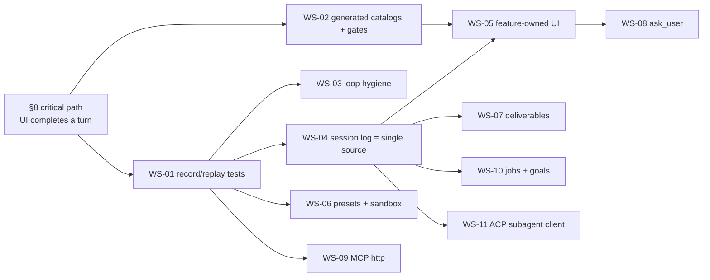

# `review/dsh-integration/` — integration pack: DeepSeek Harness practices and features → Harness-Zero

This folder turns `review/RESEARCH_DEEPSEEK_HARNESS.md` into executable work. It is written for the build agent: every workstream (WS) is a self-contained specification with the current state of Harness-Zero (file:line, verified), the design in Harness-Zero's own vocabulary, the exact files to add or modify with code skeletons, the tests that must exist, acceptance commands, and a ready-to-paste agent brief.

The specs in this folder do not change the runtime. **No workstream may be started before the v0.2.1 review's §8 critical path (client SSE listeners, `submit_turn` payload, session bootstrap, error surfacing) is merged** — several workstreams assume a browser that can complete a turn. That critical path was executed and verified on this branch: see `FLOW_TEST_FINDINGS.md` (what was broken, what was changed in `harness/`, which test proves each fix) and `scenarios/` (the runnable record/replay suite that produced the findings — WS-01 in working form).

## Files

| File | What it is |
|---|---|
| `FLOW_TEST_FINDINGS.md` | **Executed** flow-of-information test: 12 findings (6 × P0 fixed, 3 × P1 fixed, 3 documented for their workstream), the exact `harness/` files touched, a per-subsystem coverage matrix (what is proven, what is not), reproduction commands. |
| `scenarios/` | 20 runnable record/replay scenarios (`pytest review/dsh-integration/scenarios -q`): real kernel + real web daemon + the shipped client in jsdom, model replayed from `provider.jsonl`, goldens per scenario; covers turns, approvals, thinking, memory, skills, MCP, diff/checkpoints, auth, jail/Tirith/secret guardrails, page refresh. `scenarios/README.md` documents the schema and how to move it into `tests/`. |
| `00_PRINCIPLES.md` | The six invariants borrowed from `dsh`, each with the Harness-Zero rule and the CI check that enforces it. Read first; every WS cites them. |
| `plan.yaml` | Machine-readable index: workstreams, dependencies, effort, `dsh` references, files to add/modify, tests, acceptance commands. |
| `templates/PLUGIN_TEMPLATE.md` | The standard layout every new plugin must follow (manifest, `plugin.py`, README contract, conformance test, settings schema). |
| `WS-01_record_replay_tests.md` | Keyless record/replay golden tests that boot the real kernel (and the web daemon) against recorded provider streams. |
| `WS-02_generated_catalogs_gates.md` | `harness catalog` (plugins, tools, settings, events, UI contract) generated from the running registry; CI fails on drift. |
| `WS-03_loop_hygiene.md` | Tool-result pruner, spill-to-file, repeat-call reminder, cooperative tool timeout, read-before-edit. |
| `WS-04_session_log_single_source.md` | One append-only, versioned session log; `derive_messages()`; durable vs live events; checkpoints; UI renders the log. |
| `WS-05_feature_owned_ui.md` | Settings tabs and conversation renderers exist only because a plugin registered them; static contract test. |
| `WS-06_permission_presets_sandbox.md` | Presets = sandbox mode + approval policy; OS process confinement (bwrap / Seatbelt) behind the executor seam. |
| `WS-07_deliverables_workspace_changes.md` | Changed-files summary per turn from the checkpoint shadow repo; `present` tool; `workspace.changes` event + card. |
| `WS-08_ask_user_tool.md` | `ask_user_question` tool over the existing form/approval channel. |
| `WS-09_mcp_http_transport.md` | Streamable-HTTP MCP transport, per-call timeout, cancellation, reconnect with backoff. |
| `WS-10_jobs_and_goals.md` | Background jobs (`job_output/list/kill`) and one durable goal per session with a round driver. |
| `WS-11_subagent_acp_client.md` | ACP *client*: run another agent (`dsh`, Claude Code, Codex, another Harness-Zero) as a subagent. |

## Order and dependencies

Recommended sequence: **WS-01 → WS-02 → WS-03 → WS-04 → WS-05 → WS-07 → WS-08 → WS-06 → WS-09 → WS-10 → WS-11.** WS-01 and WS-02 come first on purpose: they are the mechanisms that would have caught the three previous releases, and every later WS adds its own golden scenario and catalog entry.

## Gates that apply to every workstream

1. **One PR per WS**, titled `WS-0N: <title>`, touching only the files listed in the WS (plus its tests and docs). A WS that needs an unlisted file updates the WS document in the same PR and says why.
2. **Fail-first tests.** Each WS names at least one test that fails on `main` before the change. The PR description quotes the failing assertion.
3. **No placeholders.** A UI element, command, settings key or tool may be added only together with the code that makes it work and the test that proves it (Principle P2). `data-notice`, `noop`, hard-coded sample data and "coming soon" are rejected in review.
4. **Hermetic CI stays green**: `ruff check .`, `pytest -q`, `harness plugin doctor --all`, `harness events schema | diff docs/events.schema.json -`, and — after WS-02 — `harness catalog --check`.
5. **Docs are generated or verified.** Hand-written prose may describe intent; any list of tools, plugins, settings, events or UI elements is generated (WS-02). The CHANGELOG entry for a WS links to catalog diffs, not to adjectives.
6. **Attribution.** `dsh` is MIT. Ideas need no attribution; code ported verbatim (e.g. bwrap/Seatbelt profile construction) gets an entry in `THIRD_PARTY_NOTICES.md`.

## Status

| WS | Status | PR |
|---|---|---|
| WS-01 | specified | — |
| WS-02 | specified | — |
| WS-03 | specified | — |
| WS-04 | specified | — |
| WS-05 | specified | — |
| WS-06 | specified | — |
| WS-07 | specified | — |
| WS-08 | specified | — |
| WS-09 | specified | — |
| WS-10 | specified | — |
| WS-11 | specified | — |

Update this table (and `plan.yaml` `status:`) in the PR that lands each WS.

## How this pack was produced

Facts about Harness-Zero are from the three reviews in `review/` and from reading the tree at `f43c272` (line numbers cited are from that commit; re-check them before editing). Facts about `dsh` are from `deepseek-ai/deepseek-harness` @ `86a40220` (paths in each WS under "dsh reference"). No `dsh` code is copied into this pack.
